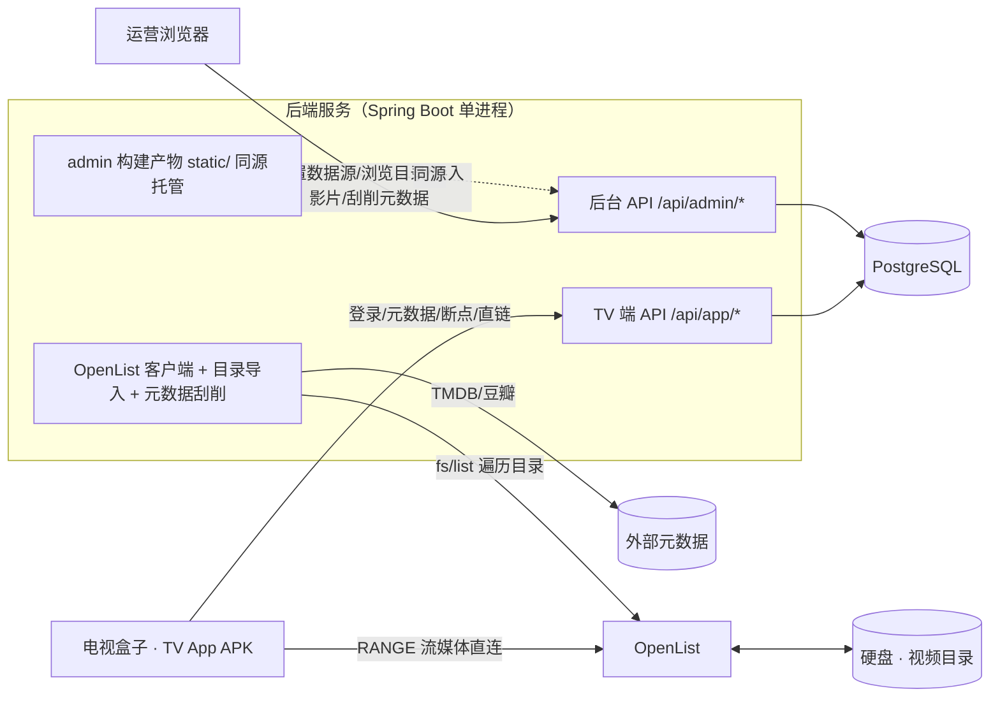
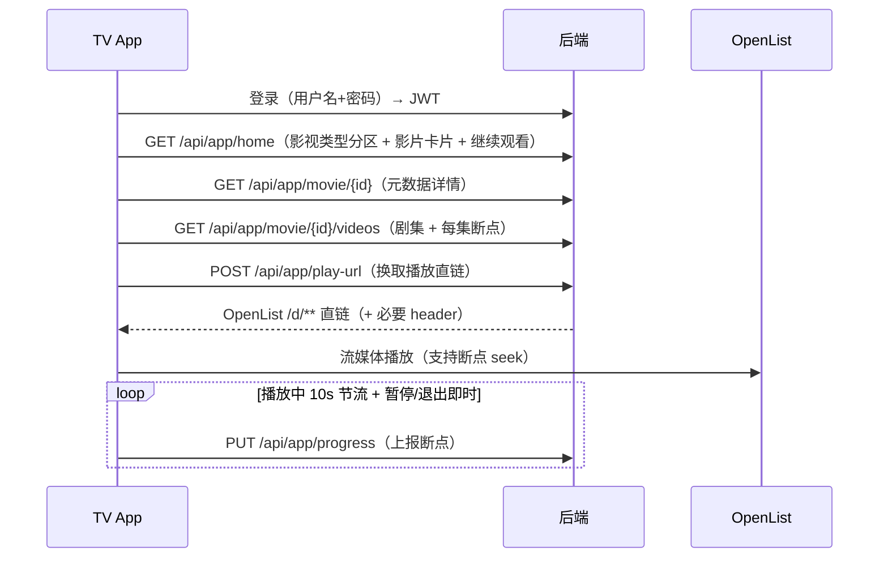
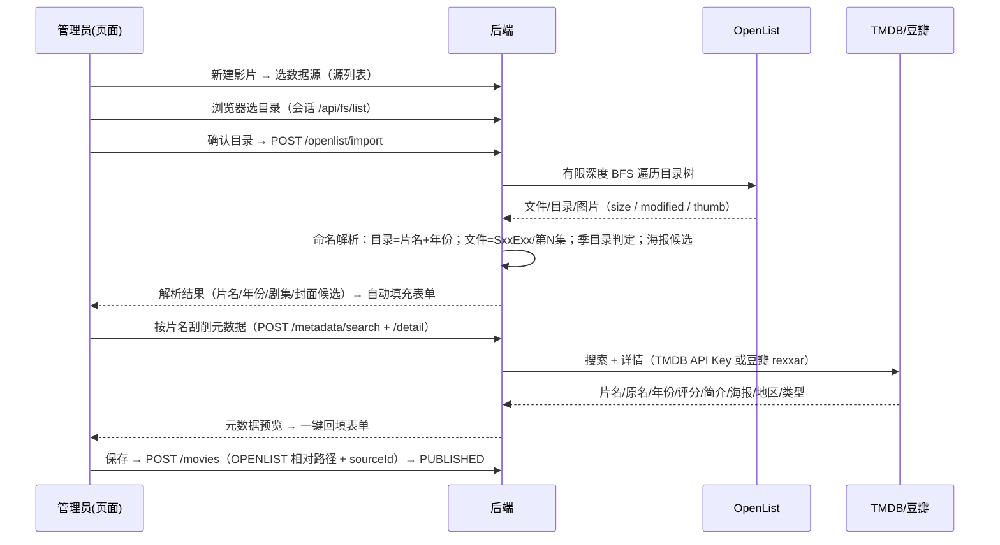

# HyperMux TV · 整体开发计划（总纲）

> **版本**：v0.7 · **状态**：v3（2026-10-11）取消「影片池」，改为「影视类型」（category，可自定义；movie.category_id 归属）；v2 起 OpenList 收敛为数据源 + 新建影片导入 + 按片名元数据刮削（TMDB/豆瓣），全量刮削/候选审核已移除。M0 ✅、M1 ✅、M3 ✅、M2 TV App 暂缓（约定不写）、**M2P 手机端计划书就绪（2026-10-11，本轮实施目标）**。
> **2026-10-19 现状更新**：M2 TV App 已交付（`hyper-mux-android-tv/`，0.1.0）；M2P 手机 App 已交付（`hyper-mux-android/`，0.1.12）；`hyper-mux-web/` Web 播放端已交付；角色显示名「TV 用户」→「普通用户」（role=0，手机/TV/Web 多端通用）；两端 App 的公开服务器地址改为构建期注入（`-PhypermuxPublicServerUrl`，未注入则用户自填）。当前状态与构建命令以 [README.md](./README.md) 为准，本文档保留为规划总纲。
> **定位**：本文档是全局总纲，只定"结构、边界、关键决策、节奏"。各模块的字段级契约、页面、解析规则等**详细设计在 docs/plans/ 中展开**（见 §11）。
> **已锁定**（2026-10-09/11）：Naive UI ✅ · 用户名+密码登录 ✅ · 元数据刮削改为**按片名即时刮削并回填表单**（TMDB/豆瓣可切换）✅ · OpenList 公网直连（无中转）+ 仅作数据源 ✅

---

## 0. 项目概述

**一句话**：给电视盒子（Android TV）做一套原创观影系统——用户在 TV 端登录后浏览「影视类型」分区、查看影片元数据、播放并自动续播；运营人员在 Web 管理后台**手动配置**影片资源，或从 **OpenList 数据源选目录导入**并**按片名刮削元数据**后上架。

**交付物（三个工程 + 一个外部依赖）**：

| 工程 | 形态 | 说明 |
|---|---|---|
| `hyper-mux-android/`（兄弟工作区） | 安卓手机原生 App（Kotlin / Jetpack Compose） | 用户登录、影视类型分区浏览、全局搜索、元数据展示、播放、断点续播、历史记录（本轮实施目标，详细设计见 `docs/plans/45-phone-app-detailed.md`） |
| `app/` | Android TV 原生 APK（Kotlin） | TV 端同功能（Leanback 遥控器交互）——暂缓 |
| `server/` | Spring Boot 后端（Java 17 / Maven / MyBatis-Plus / PostgreSQL） | 同时承载 TV 端接口与后台管理接口；OpenList 目录导入 + 元数据刮削 |
| `admin/` | Web 管理后台（Vue 3） | 影视类型/影片/剧集配置、OpenList 数据源、系统设置、用户管理 |
| （外部）OpenList | 已部署的文件列表服务 | 挂载硬盘（本地盘 / WebDAV / 云盘），提供目录列表 API 与视频直链 `/d/**` |

> **与相邻项目的关系**：兄弟工作区 `hyper-mux-care`（老花镜老人观影）验证过的架构经验（Leanback + Media3、SpringBoot + MyBatis-Plus + PG、管理后台打进 `static/` 同源部署）在本项目复用；本项目把"授权码"升级为**真实用户登录体系**，资源模型从"剧+集两张表"扩展为**影视类型 + 影片 + 标签**的通用模型。

---

## 1. 角色与核心流程

**两个角色**：

- **TV 端用户**：账号密码登录遥控器输入 → 浏览影视类型分区 → 看详情（封面/评分/标签/简介）→ 选集播放 → 断点续播 → 历史记录。
- **管理员（运营）**：登录后台 → ① 新建影片：从 OpenList 选目录自动填充剧集，按片名刮削元数据补全（TMDB/豆瓣）→ 发布上架；② 手动配置影片（封面、评分、标签、剧集直链）；③ 维护 OpenList 数据源（仅配置）与用户。

### 1.1 总体数据流



**两条内容生产路径（最终汇合到同一个影片库）**：

1. **手动路径**：后台逐条录入 → 上架（小规模 / 精修片源）
2. **导入路径（重点）**：新建影片选 OpenList 目录 → 目录内文件自动解析成剧集 → 按片名刮削元数据补全 → 保存上架（大批量片源即时可做）

### 1.2 TV 端观影流



### 1.3 新建影片 · 导入与元数据刮削流（重点）



---

## 2. 产品范围

### 2.1 本期做（In Scope）

| 模块 | 要点 |
|---|---|
| **TV 端用户登录** | 账号密码 + JWT；遥控器大字输入页；token 本地持久化、失效自动回登录页 |
| **影视类型浏览** | 首页 = 类型分区（电视剧/电影/综艺…，可自定义），分区内影片卡片流（封面/评分/年份/续播角标）；搜索（片名/年份） |
| **影片元数据展示** | 详情：封面、评分、年份、地区、语言、标签、简介、剧集列表（季/集）——全部来自后端接口 |
| **播放** | ExoPlayer 直放 OpenList 直链（MP4/MKV/HLS 均可）；全屏、大遥控器焦点 |
| **断点续播** | 按 用户 × 剧集 维度记录；10s 节流上报 + 暂停/退出补报；进入自动 seek；首页"继续观看"位 |
| **历史记录** | 按用户最近播放列表（含进度条），可标记看完/移除 |
| **后台·影视类型** | 影视类型 CRUD（预置电视剧/电影/综艺/动漫/纪录片，可自定义新增，每部影片归属一个类型）+ 影片 CRUD（封面 URL、评分、标签多选、简介、排序、上下架）+ 剧集管理（单条 + 批量粘贴直链导入） |
| **后台·OpenList 数据源** | 仅登记站点（地址 / API Token 或账密换取 / 默认根目录）+ 连通性测试；供组装播放直链与浏览目录 |
| **后台·新建影片（重点）** | 从数据源选目录 → 自动解析片名/年份/剧集/封面候选 → 回填表单；按片名刮削元数据（TMDB/豆瓣可切换）→ 回填片名/原名/年份/评分/简介/封面/地区/标签 |
| **后台·用户管理** | 用户增删、重置密码、启停、查看用户播放概况 |
| **稳定性底线** | 配置本地缓存降级、列表分页、统一错误提示，不白屏不崩溃 |

### 2.2 本期不做（Out of Scope，预留）

- 外部元数据源批量预刮（TMDB/豆瓣按**逐个**片名刮削已支持；批量后台跑批、演员/国家映射精化——暂缓）
- 字幕、清晰度切换、转码
- 影片多池归属 / 个性化推荐 / 评分上报（模型预留，逻辑后期）
- 设备绑定、家长控制、多语言
- App 热更新；TV 端语音控制

---

## 3. 数据模型总览（PostgreSQL，约 10 张核心表）

> 字段级 DDL、索引策略在详细计划 `docs/plans/10-data-model.md` 展开，此处只定骨架。

| 表 | 职责 | 关键字段（示意） |
|---|---|---|
| `sys_user` | 普通用户 + 管理员（role 区分：0 普通用户（手机/TV/Web 多端通用） / 1 管理员） | `username`、`password_hash`(BCrypt)、`nick_name`、`role`、`status`、`last_login_time` |
| `category` | **影视类型**：TV 首页的分区（电视剧/电影/综艺…，可自定义） | `name`、`cover_url`、`description`、`sort_no`、`status` |
| `movie` | **影片（作品）**：归属一个影视类型，手动或导入产生 | `category_id`、`title`、`original_title`、`year`、`cover_url`、`rating`(decimal)、`area`、`language`、`intro`、`episode_total`、`status`(DRAFT/PUBLISHED/OFF)、`source_type`(MANUAL/SCRAPE)、`source_id`、`source_path`、`sort_no` |
| `tag` / `movie_tag` | 标签体系（类型/地区/自定义）与影片多对多 | `name`、`type`；中间表 `movie_id`+`tag_id` |
| `video` | **剧集**：影片下的可播放单元 | `movie_id`、`season_no`、`episode_no`、`title`、`duration`、`size`、`url_kind`(OPENLIST 相对路径 / REMOTE 完整链接)、`openlist_path`、`source_file`(名称)、`fingerprint`(size+modified)、**unique(movie_id, season_no, episode_no)** |
| `play_progress` | **断点续播 / 历史**：用户 × 剧集 | `user_id`、`movie_id`、`video_id`、`position_ms`、`duration_ms`、`finished`、`update_time`，**unique(user_id, video_id)**，upsert 无锁 |
| `openlist_source` | **OpenList 数据源**（仅配置，组装直链） | `name`、`server_url`、`api_token`(服务端加密存储，永不出参)、`root_path`(默认浏览根目录)、`status` |
| `sys_config` | **系统设置**（键值对） | `config_key`(pk)、`config_value`：当前承载 元数据刮削来源（tmdb/douban）+ TMDB API Key |
| `app_config`（预留） | 全局展示配置（首页公告等） | 暂缓建表，需要时加 |

**影片状态机**（核心规则）：

```
手动 / 导入创建 ──────────────────────────► PUBLISHED（上架，TV 可见）
任意上架态 ─► OFF（下架）；删除影片级联删剧集，断点保留（按 user×video 历史存档可选）
```

---

## 4. API 总览

> 字段级契约（请求/响应示例、错误码）在 `docs/plans/30-api-contract.md` 展开。约定：统一响应包装 `R<T>{code,msg,data}`；TV 端与后台用**不同前缀 + 各自 JWT**（签发同一套 `sys_user`，按 role 拦截）；分页 `page/size`。

### 4.1 TV 端（`/api/app/*`，需用户 JWT）

| 方法 | 路径 | 说明 |
|---|---|---|
| POST | `/api/app/auth/login` | 登录，返回 token + 用户信息 |
| GET | `/api/app/home` | 首页聚合：影视类型分区列表 + 各类型影片摘要 + 我的继续观看（断点合并查询，无 N+1） |
| GET | `/api/app/category/{categoryId}/movies` | 类型内影片分页列表（支持 keyword 搜索、续播角标） |
| GET | `/api/app/movie/{id}` | **影片元数据**（封面/评分/标签/简介/年份/地区） |
| GET | `/api/app/movie/{id}/videos` | 剧集列表（按季分组）+ 每集续播位 |
| POST | `/api/app/play-url` | 传 `videoId` → 服务端组装 OpenList `/d/**` 直链 + 必要 header（token 不下发） |
| GET | `/api/app/history` | 最近播放（默认 20 条） |
| PUT | `/api/app/progress` | 断点上报（upsert） |
| POST | `/api/app/progress/finish` | 标记看完 / 从历史移除 |

### 4.2 后台（`/api/admin/*`，需管理员 JWT）

| 分组 | 端点（简写） | 说明 |
|---|---|---|
| 认证 | `POST /auth/login` | 管理员登录 |
| 影视类型 | `GET/POST /categories`、`PUT/DELETE /categories/{id}` | 类型 CRUD（可自定义） |
| 影片 | `GET /movies`（筛选）、`POST /movies`、`PUT/DELETE /movies/{id}`、`POST /movies/{id}/publish`、`POST /movies/{id}/offline` | 手动配置主链路 |
| 剧集 | `PUT /movies/{id}/videos`（列表批量 upsert）、`DELETE /videos/{id}` | 支持粘贴直链批量导入 |
| 标签 | `GET/POST/PUT/DELETE /tags` | 标签维护 |
| 用户 | `GET /users`、`POST /users`、`PUT /users/{id}`（重置密码/启停） | 用户管理 |
| OpenList 源 | `GET/POST /sources`、`PUT/DELETE /sources/{id}`、`POST /sources/{id}/test`（连通性探测）、`POST /openlist/session` + `POST /openlist/session/{id}/list`（会话代持 Token、目录浏览） | 仅配置数据源（地址/凭据/默认根目录） |
| 目录导入 | `POST /openlist/import {sourceId,path}` → 目录名解析片名/年份 + 文件解析剧集 + 封面候选 | 新建影片「从 OpenList 导入」 |
| 元数据刮削 | `GET /metadata/search`（按片名，provider 可切换）、`GET /metadata/detail`（详情回填） | TMDB / 豆瓣 |
| 系统设置 | `GET/PUT /settings`（metadataProvider、tmdbApiKey） | 刮削来源配置 |

---

## 5. 重点：OpenList 数据源 + 目录导入 + 元数据刮削

### 5.1 为什么走 OpenList、而不是直读目录

- OpenList 已把"本地盘 / WebDAV / S3 / 云盘"统一成 REST（`/api/fs/list` 列表、`/d/**` 直链），**后端不接触文件系统**，只认 `server_url + path`——硬盘挂了、源盘换了，只改配置不动代码。
- 直链天然给 TV 端用：`video` 表只存**相对路径**，播放时由后端 `/api/app/play-url` 组装下发，OpenList Token 永不出后端。
- 前提（已确认）：**OpenList 已部署在公网**，TV 盒子直连公开直链即可，**无需后端流中转**。
- **v2 定位**：OpenList 只作为「数据源」被登记与浏览；不再承载全量/增量刮削与候选审核，改由运营在**新建影片**时按需选目录导入。

### 5.2 能力拆分

| 能力 | 级别 | 说明 |
|---|---|---|
| **数据源配置** | ✅ 本期 | 增删改查、状态启停、连通性探测（`ping` = version + fs/list）；凭据 AES-256-GCM 加密、永不出参；默认根目录供浏览起步 |
| **目录浏览** | ✅ 本期 | `POST /openlist/session`（token/账密/sourceId 任一）→ 会话代持 → `POST /openlist/session/{id}/list` 分页浏览；重启即失效、30min TTL |
| **目录导入解析** | ✅ 本期（重点） | `POST /openlist/import`：对选中目录做有限深度 BFS（≤3 层，子目录不可读时跳过不阻塞）→ 目录名解析片名+年份、文件名解析季/集（SxxExx→第N集→自然序）、季目录判定、海报候选；返回全部剧集与封面供自动填充 |
| **元数据刮削** | ✅ 本期 | `GET /metadata/search` + `/metadata/detail`：按片名经 **TMDB**（需 API Key）或 **豆瓣**（免 Key，rexxar 接口，尽力而为）取 片名/原名/年份/评分/简介/海报/地区/类型 → 回填新建表单；来源与 Key 在「系统设置」切换 |
| NFO 文件解析 | 预留 | `.nfo`/`tvshow.nfo` 若目录里有则解析并入（实现成本低，后续顺带） |

### 5.3 目录导入的识别规则（内置默认，非源级配置）

```
根路径/
├─ 狂飙 (2023)/            ← 在导入器里选中该目录 ⇒ 一部影片
│  ├─ poster.jpg           ← 封面候选
│  ├─ 狂飙.E01.1080P.mkv   ← 剧集（解析第 1 集）
│  └─ ...
└─ 鱿鱼游戏 (2021)/
   ├─ S01/ E01..E09.mkv    ← 季目录：S01E01
   └─ S02/ ...
```

- **媒体文件**：内置扩展名白名单（`mkv mp4 avi ts flv m4v mov wmv m2ts mpg mpeg 3gp`），忽略隐藏文件与环境音（`.part/.!qB/aria2/sample/Sample/样本`）。
- **命名解析**（沿用 M4 解析器单测 80 项语义）：
  - 目录名：`^(?P<title>.+?)[\s_]*[（(](?P<year>19xx|20xx)[)）]$` → 片名+年份；`title year`（空格/点/下划线）次之；裸名兜底（年份 null）
  - 文件集号：`SxxExx` → 季/集；`第X季…第N集` → 季/集；`第N集` → 集；独立数字 → 集（标记"猜的"）；都没有 → 自然序补号
  - 季目录：`S01 / Season1 / 第2季 / 第二季`（含"目录名首段 Sxx"容忍）；选中目录内（含季/清晰度子目录）统一归属该片
- 解析结果仅作**预览回填**，保存由运营在表单里确认。

### 5.4 元数据刮削（TMDB / 豆瓣可切换）

- **TMDB**（推荐，稳定规范）：`search/multi` + `movie|tv/{id}`，`language=zh-CN` 直取中文；海报拼 `image.tmdb.org/t/p/w500`；需在「系统设置」填 API Key。
- **豆瓣**（免 Key，尽力而为）：搜索 `m.douban.com/rexxar/api/v2/search/subjects`（需移动端 Referer/UA）；详情 `rexxar/api/v2/movie|tv/{id}`；可能限流/改版，失败或缺字段由管理员手补。
- 国家/地区归一：ISO 码与中文全称（中国大陆→中国、中国香港/台湾→港台 等）统一映射到平台的地区标签口径。
- 回填行为：片名/原名/年份/评分/简介/封面/地区写字段；类型与地区**尝试匹配平台已有标签**（匹配不到不新增）。

### 5.5 直链策略

| 项 | 策略（已确认） |
|---|---|
| **直连（唯一策略）** | TV 直连 `https://<OpenList 公网地址>/d/<path>`；由服务端 `/api/app/play-url` 统一组装下发（路径按段 percent-encode），如 OpenList 侧要求 Referer/UA 则随响应一并下发给 ExoPlayer |
| **直链安全边界** | OpenList 本身公开，直链访问控制（Token / CDN / 白名单）属 OpenList 自身策略，**不在本项目范围**；API Token 仅服务端加密存储，永不下发前端/TV |
| **防直链外播（M5 可选微项）** | play-url 返回值附加 `sign + exp` 签名过期参数，限制直链被第三方复用/缓存（视 OpenList 转发行为取舍） |

### 5.6 v2 验收口径

1. OpenList 数据源页：创建/编辑/删除/启停/测试连接全通，token 永不出参；
2. 新建影片选择真实 OpenList 目录 → 片名/年份/季/集自动解析回填（标准命名正确率 ≥90%，异常命名优雅降级）；
3. 子目录不可读（网盘个别目录异常）不阻塞整次导入，有跳过提示；
4. TMDB（配 Key）与豆瓣搜索/详情可走通，一键回填表单后保存即上架；
5. 未上架/下架影片 TV 端不可见（V1 铁律保留）。

> **v2 状态：✅ 已达成（2026-10-11）。** 实机源（OpenList v4.1.8 + 123pan 挂载）端到端验证：目录导入扫描真实库 31 目录 / 559 集解析通过；豆瓣搜索与详情走通；解析器单测 80/80。`tools/smoke-m4.ps1` 描述的"全量/增量/候选审核"链路已随 v2 移除，不再适用。

---

## 6. 技术选型

| 模块 | 选型 | 理由 / 关键约束 |
|---|---|---|
| **TV App** | Kotlin + Gradle KTS（AGP 8.x）；minSdk 24 / target 34；AndroidX **Leanback**（`feature leanback` 声明 `required="false"`）+ **Media3 ExoPlayer** 1.4+（MP4/MKV/HLS 核心库自带）；Retrofit2 + OkHttp + Coroutines + Coil；断点/配置缓存 SharedPreferences | 遥控器焦点导航原生体验最佳；Leanback 兼容普通盒子 |
| **后端** | **Java 17 + Spring Boot 3.3.x**；**MyBatis-Plus `mybatis-plus-spring-boot3-starter` 3.5.9+**（SB3 适配硬性要求）；**Lombok**；**Maven**；**PostgreSQL**（14+）；JSON 用默认 Jackson（与 care 项目的 fastjson2 不同，本项目意见统一后锁定）；JWT 用 jjwt（或 Sa-Token，详设定）；密码 BCrypt；刮削异步用 `@Async` 线程池 + 任务表 | 用户指定栈；单进程部署，App 端/后台接口同进程、不同前缀 |
| **OpenList 客户端** | Spring `RestClient`（SB3 自带）或 OkHttp；token 不进前端 | 走 `/api/fs/list`（分页）与 `/d/**`；超时/重试/并发分页 |
| **管理后台** | Vue 3 + TypeScript + Vite 5 + **Naive UI**（已确认）+ Pinia + vue-router(hash) + axios | 与 care 项目保持一致；构建产物打进后端 `static/` **同源部署，零跨域零 Nginx** |
| **数据库** | PostgreSQL；`schema.sql` 手动初始化（M5 可引入 Flyway） | 唯一约束保证 upsert 幂等；jsonb 存刮削资产 |
| **部署** | docker-compose（postgres + server）；APK 手动装盒子；server 同机 Nginx 可选 | 自托管单节点足够 |

---

## 7. 仓库与目录结构（Monorepo）

```
hyper-mux/
├─ PLAN.md                     # 本总纲
├─ docs/plans/                 # 详细计划（见 §12，逐个写）
├─ server/                     # Spring Boot 后端（Maven 单模块）
│  ├─ sql/schema.sql           # 建表 + 种子
│  └─ src/main/java/com/hypermux/server/
│     ├─ app/                  # /api/app/* 控制器与服务
│     ├─ admin/                # /api/admin/* 控制器与服务
│     ├─ scrape/               # ★ OpenList 数据源 / 目录导入 / 元数据刮削（client / 解析器 / import / metadata）
│     ├─ auth/                 # JWT 签发与拦截
│     └─ common/               # R<T> / 异常 / 配置
├─ admin/                      # 管理后台（Vue 3）
├─ web/                        # Web 端（Vue 3，兄弟工作区 hyper-mux-web）
├─ hyper-mux-android/          # 安卓手机 App（Kotlin / Compose，兄弟工作区，本轮实施）
├─ app/                        # Android TV App（Kotlin，暂缓）
└─ docker-compose.yml          # M5 引入
```

- Java 包根：`com.hypermux.server`；App 包名：`com.hypermux.tv`。
- Git 仓库在本目录一次性建（三个工程同仓库，一 PR 全联调）。

---

## 8. 里程碑计划

> 按 **1 名全职开发** 的粗估（人日），里程碑之间可并行（后端/前端/TV 线）。含 M6 前约 **4～4.5 周**。

| 里程碑 | 内容 | 产出 | 粗估 | 进度 |
|---|---|---|---|---|
| **M0 脚手架** | 三工程初始化可跑通；DB 建表脚本；统一响应/异常；health 接口；admin 打进 static 验证同源 | 三个工程本地一键启动 | 1d | ✅ 完成（2026-10-09） |
| **M1 后端主链路** | 登录鉴权；pool/movie/video/tag CRUD 接口；TV 端 home/详情/剧集/断点接口；play-url 直链组装（REMOTE 直链即可） | 手动配置路径**用 curl 全通**；接口文档初稿 | 4–5d | ✅ 完成（2026-10-09，冒烟 55/55） |
| **M2 TV App MVP** | 登录页（大字输入）；首页池区卡片流；详情页；剧集页；ExoPlayer 全屏播放；断点 10s 节流上报 + 自动续播；历史页；本地缓存降级 | 真机 APK：登录→浏览→播放→关机→再开自动续播 | 5–6d | ⏸ 暂缓（2026-10-10 决定：本期不写 TV App，`/api/app/*` 接口已就绪可直连） |
| **M2P 手机端 MVP** | 安卓手机原生（Kotlin/Compose）：登录、首页（分类+继续观看）、分类列表、全局搜索、详情（内嵌剧集）、播放（续播/连播/手势/断点）、历史、我的（服务器地址配置）、离线降级；**后端零改动**，复用 `/api/app/*` | 手机 APK：登录→浏览→搜索→播放→断点→历史全链通，计划书 `docs/plans/45-phone-app-detailed.md` | 约 9d（P0–P4） | 🟡 P0–P4 已实施并可编译出包（2026-10-11）：debug 21.1MB / release 2.6MB 产于 `hyper-mux-android/dist/`；**真机手测待执行**（清单见 `hyper-mux-android/docs/build-and-acceptance.md`） |
| **M3 管理后台 MVP** | 登录；影片池/影片/剧集 CRUD 页面（含批量粘贴直链导入）；标签管理；用户管理 | 运营不碰 API 完成 M1 全部操作 | 3–4d | ✅ 完成（2026-10-10，smoke-m3 42/42 + M1 回归 55/55；范围扩展：OpenList 源 CRUD + 连通性测试 + Token 加密 + play-url 组装 + 全站 UI 重设计 + 演示数据） |
| **M4 硬盘刮削（重点）** | ~~全量/增量刮削 + 候选审核~~ **v2 已移除**；OpenList 客户端、解析器、源 CRUD / 连通性探测保留复用 | — | 5–7d | ⛔ 移除（2026-10-11，见 M4'） |
| **M4' 数据源 + 导入 + 元数据刮削（v2 重点）** | OpenList 数据源收敛为只配置；新建影片「选目录导入」自动解析填充；元数据刮削（TMDB/豆瓣可切换 + 系统设置）；候选审核/刮削任务下线 | 按 §5.6 v2 DoD 验收 | 3d | ✅ 已完成（2026-10-11）：解析器单测 80/80；实机源导入验证（31 目录/559 集）；豆瓣搜索与详情走通 |
| **M5 加固与部署** | 直链探测（批量 HEAD，验公网可达性）；play-url 签名过期（可选微项）；Caffeine 缓存 + 列表性能；日志/异常监控；docker-compose 一键起；APK 签名打包 | 500+ 影片类型首页 < 2s； compose up 全栈可用 | 3–4d | 待开始 |
| **M6 可选扩展** | ~~TMDB/豆瓣元数据自动补全~~（已于 v2 落地）；批量后台刮削、解析规则可视化编辑、播放统计看板、影片多池归属 | 按业务需要单独排期 | 3–5d | 可选 |

**顺序理由**：M1 先让"手动配置路径"端到端通（刮削的前置验证），M2 尽早拿真机暴露盒子兼容问题，M4 建在 M1 的影片模型之上——**刮削不阻塞主链路**。

---

## 9. 风险与应对

| 风险 | 影响 | 应对 |
|---|---|---|
| **OpenList 为公网地址**（已确认） | 直链/资源暴露面大 | 直链安全归 OpenList 自身策略（本项目不背）；数据源 Token 仅服务端加密存储，永不下发；M5 可选 play-url 签名过期 |
| 片库整理不规范，命名解析失败率高 | 回填结果需人工调 | 降级策略（自然序 + 手动改）+ 导入结果预览可编辑后再保存 |
| 盒子软解兼容性（HEVC/10bit 卡顿） | 播放体验差 | M2 实测盒子机型清单；文档建议 1080p H264 源；统计包报"解码失败"快速定位 |
| 片库规模上涨（数千影片） | 首页/导入变慢 | 分页 + 封面懒加载 + Caffeine 缓存；导入限深度/限目录防整站误扫 |
| OpenList API Token 泄漏 | 资源库被遍历/盗刷 | Token 仅服务端加密存储，不下发前端/TV；源配置接口按管理员权限隔离 |
| 网盘单个子目录异常（123pan 偶发） | 导入被截断 | 子目录读取失败跳过并提示 skippedDirs，不阻塞整次导入 |
| 豆瓣接口限流/改版 | 刮削失败 | 默认 TMDB；豆瓣尽力而为，缺失字段手补；两来源可切换 |

---

## 10. 已锁定决策与默认项

> 前三项由用户于 2026-10-09 确认锁定；其余沿用当前草案默认值，无异议即按默认执行（如要改，在详细计划启动前指出）。

| # | 事项 | 结论 |
|---|---|---|
| 1 | 管理后台组件库 | **Naive UI** ✅（与 care 项目一致） |
| 2 | TV 端登录形态 | **用户名 + 密码** ✅（遥控器大字输入页，token 本地持久化） |
| 3 | 元数据自动补全（TMDB/豆瓣） | **v2 已落地** ✅（2026-10-11）：按片名即时刮削并回填新建表单，TMDB/豆瓣可切换 |
| 4 | 直链/网络策略 | **OpenList 已在公网** ✅：TV 直连公开直链，**无后端流中转**；直链安全边界见 §5.6 |
| 5 | "系列相关的标签" | 默认：① 类型/地区标签体系 + ② 季/集（SxxExx）结构，两者都覆盖 |
| 6 | 影片 ↔ 影视类型归属 | 默认：**单类型归属**（一部片只在一个类型），模型可后扩多对多 |
| 7 | 字幕 / 多清晰度 | 默认：本期不做（沿用 care 结论） |

---

## 11. 后续详细计划文档规划

| 文档 | 状态 | 内容 |
|---|---|---|
| `docs/plans/10-data-model.md` | ✅ v1.1 | 完整 DDL、索引/唯一约束、状态机、upsert 策略、种子数据（v2：移除刮削列/表，新增 sys_config） |
| `docs/plans/20-backend-detailed.md` | ✅ v1.3 | 工程分包（含 M3/M4' 实际目录）、依赖版本、鉴权链路、服务边界、缓存与并发、错误码表、OpenList 客户端、**目录导入 + 元数据刮削（v2）**、测试用例、任务分解 |
| `docs/plans/30-api-contract.md` | ✅ v1.3 | 全量接口字段级契约（TV 端 9 个 + 后台/v2 接口）+ curl 示例 + 统一错误码（v2：移除刮削任务/候选，新增 /openlist/import、/metadata/*、/settings） |
| `docs/plans/40-app-detailed.md` | ✅ v1.0 | 页面清单与遥控器焦点规则、播放器状态机/断点/自动连播/错误分类、缓存降级、机型矩阵、M2 验收 |
| `docs/plans/45-phone-app-detailed.md` | ✅ v1.0 | **手机端**（本轮实施）：技术栈（Compose/Material3/Media3）、工程结构、页面规格（登录/首页/分类/搜索/详情内嵌剧集/播放/历史/我的）、手势层、播放器状态机、断点逻辑、服务器地址运行时配置、M2P 验收 DoD |
| `docs/plans/50-admin-detailed.md` | ✅ v1.1 | 信息架构、路由菜单、页面/表单规格、EpisodeTable/粘贴导入/候选审核交互、构建部署、M3/M4'/M4 验收清单（v2：移除候选审核/刮削任务页，新增系统设置、目录导入与元数据弹窗） |
| `docs/plans/60-scrape-engine-detailed.md` | ⛔ v1.0（引擎已废弃） | 解析器全量用例表（M1~14 / E1~16 / 季/自然序/ignore）**仍为目录导入复用**；全量/增量/diff/调度章节描述 v1 引擎，v2 已移除 |
| `docs/plans/70-deploy-ops.md` | ✅ v1.0 | docker-compose/Dockerfile、密钥红线、首次安装 Runbook、HTTPS 反代、性能预算压测、日志监控排障、备份升级回滚、安全清单、M5 Checklist |

**文档全部完成（8/8）。M0、M1、M3 已完成（2026-10-09/10）**：
- `server/`（Spring Boot 3.3.13 / Java 17）：统一响应/异常、双前缀 JWT 鉴权（每请求回库校验）、启动幂等迁移（`src/main/resources/sql/schema.sql`+`seed.sql`，显式 UTF-8 读取）+ admin 自举、trace 日志、actuator(:9090)。库已建 9 张表并灌入 15 个默认标签，`admin/Admin@1234` 可登录。
- M1 主链路：pool/tag/user 全 CRUD + 影片 CRUD（发布/下架、同池同名 409 保护、级联删除统计）+ 剧集管理（列表/全量替换/文本导入）+ 仪表盘聚合 + TV 端 9 接口（home/池列表/详情/剧集/play-url/断点上报/看完移除/历史）。可见性铁律单点实现（`MovieQueryService.requireVisibleMovie`，DRAFT/下架/池停用/无剧集一律 404）。`tools/smoke-m1.ps1` 冒烟 **55/55 全过**（含角色互访 403、池删除保护 409+data、用户删除后 token 即时 401）。
- M3 管理后台 + OpenList 源（2026-10-10）：`admin/` 全站 UI 重设计（圆角卡片 + 动画 + 深色侧栏 + 登录 aurora 页，theme-overrides 主题化）；8 个业务页全落地（总览/池/影片列表/影片详情+编辑/新建+剧集粘贴导入/标签/用户/数据源卡片页含连接测试与删除守卫）；`scrape/` 域包 OpenList 源 CRUD（AES-256-GCM Token 加密、创建两步探测 version+fs/list、删除 409/423 守卫）+ `PlayUrlService` 播放地址实锤组装（`{serverUrl}/d/{分段编码}`，空格→`%20`）。`tools/smoke-m3.ps1` 冒烟 **42/42 全过** + M1 回归 **55/55**。演示数据已播种（2 池 / 2 片 / mock 源 / `tv_demo` 用户），中文截图教程见 `docs/使用教程.html`。
- 本机速查见 `README.md`；TV App（`app/`）按约定暂缓（`/api/app/*` 已就绪）。
- **v2（2026-10-11）OpenList 定位调整**：数据源只配置；新建影片「从 OpenList 导入」自动解析回填 + 按片名刮削元数据（TMDB/豆瓣切换）；移除刮削任务/候选审核（含 `scrape_task` 表与 `scrape_assets` 列，启动迁移幂等清理）。实机源验证：导入扫描 31 目录 / 559 集、豆瓣搜索与详情走通；解析器单测 80/80 保留。
- 实施中确定的两条工具链事实（已回写 20-backend §2）：MyBatis-Plus 3.5.9 分页插件须显式依赖 `mybatis-plus-jsqlparser`；Windows/GBK 平台执行 SQL 脚本必须显式 UTF-8。
