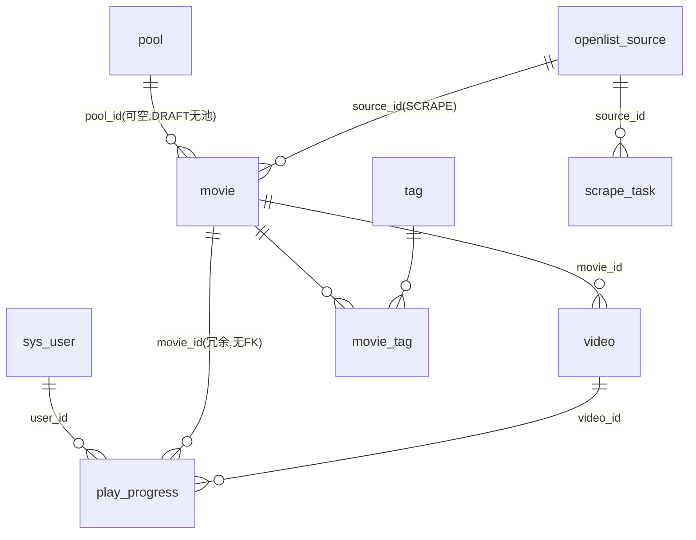

# 10 · 数据模型详细设计（PostgreSQL）

> 隶属：[PLAN.md](../../PLAN.md) §3 的落地版 · 版本 v1.2 · 对应里程碑：M0 建库 / M1 主链路 / M4'（2026-10-11）
> **v1.2（v3）**：`pool`（影片池）→ `category`（影视类型，可自定义）；`movie.pool_id` → `movie.category_id`（每片归属一个类型，TV 首页按键分区）；唯一索引 `uk_movie_pool_title/idx_movie_pool_status` → `uk_movie_category_title/idx_movie_category_status`。迁移见 schema（幂等）。
> **v1.1（v2 定位调整）**：`openlist_source` 移除刮削配置列；删除 `scrape_task` 表；`movie` 移除 `scrape_assets` 列与 `uk_movie_source_path` 索引；新增 `sys_config`（键值对：元数据来源 + TMDB Key）。
> 约定：库名 `hypermux`；时区一律 `timestamptz`；JSON 字段一律毫秒时间戳（给客户端用）。

---

## 1. 总览

| 表 | 责任 | 产生方式 | 删除策略 |
|---|---|---|---|
| `sys_user` | TV 端用户 + 管理员（role 区分） | 后台手工 | 级联删其断点 |
| `pool` | 影片池（TV 首页分区） | 后台手工 | 有影片时禁止删（409） |
| `movie` | 影片（作品） | 手工 / **刮削候选** | 级联删剧集→级联删断点 |
| `tag` / `movie_tag` | 标签体系（类型/地区/自定义） | 后台手工 + 种子 | tag 删除自动解绑影片 |
| `video` | 剧集（可播放单元） | 手工 / 粘贴导入 / 刮削 | 随 movie 级联；单独删走"全量替换" |
| `play_progress` | 断点续播 + 历史 | TV 端上报（upsert） | 随 user 或 video 级联 |
| `openlist_source` | OpenList 源配置（刮削入口） | 后台手工 | 有关联影片时禁止硬删（置停用） |
| `scrape_task` | 刮削任务（观测/停止） | 引擎自动 | 随 source 级联；历史保留 |



---

## 2. 完整 DDL（`server/sql/schema.sql`）

```sql
-- ============ 用户 ============
CREATE TABLE IF NOT EXISTS sys_user (
  id              bigserial   PRIMARY KEY,
  username        varchar(32) NOT NULL,
  password_hash   varchar(100) NOT NULL,          -- BCrypt
  nick_name       varchar(64),
  avatar_url      text,
  role            smallint    NOT NULL DEFAULT 0,  -- 0 = TV 端用户 / 1 = 管理员
  status          smallint    NOT NULL DEFAULT 1,  -- 1 启用 / 0 停用
  last_login_time timestamptz,
  create_time     timestamptz NOT NULL DEFAULT now(),
  update_time     timestamptz NOT NULL DEFAULT now(),
  CONSTRAINT uk_sys_user_username UNIQUE (username)   -- 全局唯一（普通用户与管理员共池）
);

-- ============ 影片池 ============
CREATE TABLE IF NOT EXISTS pool (
  id          bigserial   PRIMARY KEY,
  name        varchar(64) NOT NULL,
  cover_url   text,                               -- 池缩略图（TV 池 Tab 图标，可空）
  description varchar(512),
  sort_no     int         NOT NULL DEFAULT 0,     -- 升序展示
  status      smallint    NOT NULL DEFAULT 1,     -- 1 启用 / 0 隐藏（TV 不可见）
  create_time timestamptz NOT NULL DEFAULT now(),
  update_time timestamptz NOT NULL DEFAULT now(),
  CONSTRAINT uk_pool_name UNIQUE (name)
);

-- ============ 影片 ============
CREATE TABLE IF NOT EXISTS movie (
  id             bigserial   PRIMARY KEY,
  pool_id        bigint REFERENCES pool(id) ON DELETE RESTRICT,  -- DRAFT 可为空；发布前必填
  title          varchar(191) NOT NULL,
  original_title varchar(191),
  year           int,
  cover_url      text,
  rating         numeric(2,1),                     -- 0.0 ~ 10.0，一位小数
  area           varchar(64),                      -- 地区（中文/韩国/日本/美国/欧美/港台…）
  language       varchar(32),
  intro          text,
  episode_total  int NOT NULL DEFAULT 0,           -- 冗余：非 missing 剧集数（服务层维护）
  status         varchar(16) NOT NULL DEFAULT 'DRAFT',
      -- DRAFT 候选（TV 不可见） / PUBLISHED 上架 / OFF 下架
  source_type    varchar(16) NOT NULL DEFAULT 'MANUAL',  -- MANUAL / SCRAPE
  source_id      bigint REFERENCES openlist_source(id) ON DELETE SET NULL,
  source_path    varchar(512),                     -- OpenList 影片目录绝对路径（SCRAPE 专用）
  sort_no        int NOT NULL DEFAULT 0,
  scrape_assets  jsonb,                            -- {"posterPaths":["/d 相对路径",...],"nfoPath":null}
  create_time    timestamptz NOT NULL DEFAULT now(),
  update_time    timestamptz NOT NULL DEFAULT now(),
  CONSTRAINT ck_movie_status  CHECK (status IN ('DRAFT','PUBLISHED','OFF')),
  CONSTRAINT ck_movie_source  CHECK (source_type IN ('MANUAL','SCRAPE'))
);
-- 上架/下架片：同池内不允许重名；DRAFT 允许重名（候选同名后人工合并/改名）
CREATE UNIQUE INDEX IF NOT EXISTS uk_movie_pool_title
  ON movie (pool_id, title) WHERE status IN ('PUBLISHED','OFF');
CREATE INDEX IF NOT EXISTS idx_movie_pool_status ON movie (pool_id, status, sort_no);
CREATE INDEX IF NOT EXISTS idx_movie_status      ON movie (status);
-- 刮削幂等锚点：同源同目录只有一部候选/影片
CREATE UNIQUE INDEX IF NOT EXISTS uk_movie_source_path
  ON movie (source_id, source_path) WHERE source_type = 'SCRAPE';

-- ============ 标签 ============
CREATE TABLE IF NOT EXISTS tag (
  id          bigserial   PRIMARY KEY,
  name        varchar(32) NOT NULL,
  type        smallint    NOT NULL DEFAULT 0,      -- 0 类型 / 1 地区 / 2 自定义
  sort_no     int         NOT NULL DEFAULT 0,
  status      smallint    NOT NULL DEFAULT 1,
  create_time timestamptz NOT NULL DEFAULT now(),
  CONSTRAINT uk_tag_name UNIQUE (name)
);
CREATE TABLE IF NOT EXISTS movie_tag (
  movie_id  bigint NOT NULL REFERENCES movie(id) ON DELETE CASCADE,
  tag_id    bigint NOT NULL REFERENCES tag(id)   ON DELETE CASCADE,
  PRIMARY KEY (movie_id, tag_id)
);

-- ============ 剧集 ============
CREATE TABLE IF NOT EXISTS video (
  id            bigserial   PRIMARY KEY,
  movie_id      bigint NOT NULL REFERENCES movie(id) ON DELETE CASCADE,
  season_no     int NOT NULL DEFAULT 1,
  episode_no    int NOT NULL,
  title         varchar(191),                       -- 可空，默认 UI 侧显示"第N集"
  duration      int,                                -- 秒（可空）
  size          bigint,                             -- 字节（可空）
  url_kind      varchar(16) NOT NULL,               -- OPENLIST / REMOTE
  openlist_path varchar(512),                       -- OPENLIST 时必填：OpenList 文件绝对路径
  remote_url    text,                               -- REMOTE 时必填：完整直链（mp4/m3u8/转码链接）
  source_file   varchar(255),                       -- 原始文件名（审核页调试/展示）
  fingerprint   varchar(64),                        -- "size-modified毫秒"（刮削 diff 用）
  missing       smallint NOT NULL DEFAULT 0,        -- 0 正常 / 1 磁盘文件消失（不物理删）
  sort_no       int  NOT NULL DEFAULT 0,
  create_time   timestamptz NOT NULL DEFAULT now(),
  update_time   timestamptz NOT NULL DEFAULT now(),
  CONSTRAINT uk_video_mov_season_ep UNIQUE (movie_id, season_no, episode_no),
  CONSTRAINT ck_video_kind CHECK (
    (url_kind = 'OPENLIST' AND openlist_path IS NOT NULL) OR
    (url_kind = 'REMOTE'   AND remote_url    IS NOT NULL)
  )
);
CREATE INDEX IF NOT EXISTS idx_video_movie ON video (movie_id, season_no, episode_no);

-- ============ 断点 / 历史 ============
CREATE TABLE IF NOT EXISTS play_progress (
  id          bigserial   PRIMARY KEY,
  user_id     bigint NOT NULL REFERENCES sys_user(id)  ON DELETE CASCADE,
  movie_id    bigint NOT NULL,               -- 冗余列（无 FK）：video 级联删时历史随 video 一起消失，
                            -- 此列仅为 join 时少一次表关联，写入时同步
  video_id    bigint NOT NULL REFERENCES video(id) ON DELETE CASCADE,
  position_ms int   NOT NULL DEFAULT 0,
  duration_ms int,
  finished    smallint NOT NULL DEFAULT 0,   -- 1 已看完
  update_time timestamptz NOT NULL DEFAULT now(),
  CONSTRAINT uk_progress_user_video UNIQUE (user_id, video_id)
);
CREATE INDEX IF NOT EXISTS idx_progress_user_time ON play_progress (user_id, update_time DESC);

-- ============ OpenList 源 ============
CREATE TABLE IF NOT EXISTS openlist_source (
  id             bigserial   PRIMARY KEY,
  name           varchar(64) NOT NULL,
  server_url     varchar(255) NOT NULL,       -- 形如 https://openlist.example.com（不带尾 /）
  api_token      varchar(512) NOT NULL,       -- AES-256-GCM 加密存储（iv|cipher, base64）
  root_path      varchar(255) NOT NULL DEFAULT '/',
  include_paths  text         NOT NULL DEFAULT '',   -- 刮削范围 JSON 数组（向导第 3 步勾选）；'' = 刮整个根目录
  match_mode     varchar(8)  NOT NULL DEFAULT 'A',   -- A: 含媒体目录=影片 / B: 一级目录=影片+Sxx季目录
  ext_whitelist  varchar(255) NOT NULL DEFAULT 'mkv,mp4,avi,ts,flv,m4v,mov,wmv',
  ignore_patterns  varchar(512) NOT NULL DEFAULT 'sample,Sample,样本,.part,.!qB,aria2',
  auto_publish   smallint NOT NULL DEFAULT 0, -- 1: 刮削即上架（跳过人工审核）
  status         smallint NOT NULL DEFAULT 1, -- 1 启用 / 0 停用（停用=藏起来，不硬删）
  last_scrape_at timestamptz,
  last_error     varchar(512),
  create_time    timestamptz NOT NULL DEFAULT now(),
  update_time    timestamptz NOT NULL DEFAULT now(),
  CONSTRAINT uk_source_name  UNIQUE (name),
  CONSTRAINT ck_source_mode  CHECK (match_mode IN ('A','B'))
);
-- 存量库补列（新装由上面 CREATE 直接带上；幂等可重复执行）：
-- ALTER TABLE openlist_source ADD COLUMN IF NOT EXISTS include_paths text NOT NULL DEFAULT '';

-- ============ 刮削任务 ============
CREATE TABLE IF NOT EXISTS scrape_task (
  id           bigserial   PRIMARY KEY,
  source_id    bigint NOT NULL REFERENCES openlist_source(id) ON DELETE CASCADE,
  type         varchar(16) NOT NULL,          -- FULL / INCREMENT
  status       varchar(16) NOT NULL DEFAULT 'RUNNING',
      -- RUNNING / STOPPING / FINISHED / FAILED / STOPPED
  scanned      int NOT NULL DEFAULT 0,        -- 已扫描目录数（进度展示）
  new_count    int NOT NULL DEFAULT 0,        -- 新增影片/剧集（候选）
  update_count int NOT NULL DEFAULT 0,        -- 指纹变化刷新数
  remove_count int NOT NULL DEFAULT 0,        -- 新发现"文件消失"数
  error        varchar(1024),
  operator     bigint,                        -- 发起人 admin id
  start_time   timestamptz NOT NULL DEFAULT now(),
  end_time     timestamptz,
  CONSTRAINT ck_task_type   CHECK (type IN ('FULL','INCREMENT')),
  CONSTRAINT ck_task_status CHECK (status IN ('RUNNING','STOPPING','FINISHED','FAILED','STOPPED'))
);
CREATE INDEX IF NOT EXISTS idx_task_source ON scrape_task (source_id, start_time DESC);
```

> `openlist_source` 必须先于 `movie` 存在（`movie.source_id` 引用它）。PostgreSQL 允许引用后创建的表（建表时 FK 只做存在性登记，引用目标不存在会报错）——**故 schema.sql 中 `openlist_source` 段落要放在 `movie` 之前执行**，上面 DDL 顺序即执行顺序（`movie.source_id` 那段注释后已调整：实际写入文件时把 `openlist_source` 表放在 `movie` 之前）。

---

## 3. 状态机

### 3.1 movie（核心）

```
                 ┌──────────── 手动创建（校验通过即上架）────────────┐
                 ▼                                                   │
            PUBLISHED ◄─── publish（候选审核通过/重新上架）─── DRAFT（刮削产出）
                 │                                                    │
                 ├────────────► OFF（下架） ◄─────────────────────────┘
                 │                                                   （仅提示，可下架灰档）
                 └► DELETE：级联 video → play_progress
DRAFT 忽略（DELETE）：仅 DRAFT 允许直接删（候选放弃）
```

**流转校验（服务层强制）**

| 动作 | 前置条件 | 失败错误码 |
|---|---|---|
| 手动创建 | `title` 非空；`pool_id` 有效且启用；`episodes>0`；(pool_id,title) 无 PUBLISHED/OFF 重名 | 400 / 409 |
| DRAFT→PUBLISHED（发布） | `pool_id` 必填；`cover_url` 必填；非 missing 剧集 ≥1 | 400（含具体缺失项） |
| PUBLISHED↔OFF | 仅状态检查 | 409（非法流转） |
| DELETE | DRAFT 直接删；PUBLISHED/OFF 前端二次确认，服务层直接级联 | - |

### 3.2 video

- 无状态机，用 `missing` 标记：`0 正常` ↔ `1 文件消失`（刮削增量发现路径不在遍历结果中时置 1；文件重出现时回 0 并刷指纹）。
- **刮削永不物理删 video 行**（防误删）：物理删除只来自 ① 剧集管理"全量替换"（后台手动提交未包含的）② movie 删除级联。
- **TV 可见性铁律**：一切 TV 端查询（home/列表/详情/剧集/历史/断点恢复）只返回
  `movie.status='PUBLISHED' AND pool.status=1 AND video.missing=0`。

### 3.3 scrape_task

`RUNNING → FINISHED / FAILED / STOPPED`，其中人工点停止先置 `STOPPING`（引擎收到后自落 `STOPPED`）。

---

## 4. Upsert 与幂等策略

| 场景 | 手段 |
|---|---|
| 断点上报（高频） | `INSERT INTO play_progress (user_id,movie_id,video_id,position_ms,duration_ms,update_time) VALUES (?,?,?,?,?,now()) ON CONFLICT (user_id,video_id) DO UPDATE SET position_ms=EXCLUDED.position_ms, duration_ms=COALESCE(EXCLUDED.duration_ms, play_progress.duration_ms), finished=CASE WHEN EXCLUDED.position_ms>=COALESCE(EXCLUDED.duration_ms,0)-30000 AND EXCLUDED.duration_ms>0 THEN 1 ELSE play_progress.finished END, update_time=now()`（≥总量-30s 自动标记看完） |
| 刮削影片唯一 | `uk_movie_source_path`（source_id+source_path，部分索引限 SCRAPE）；候选复用=同键命中已有 DRAFT/PUBLISHED 影片 |
| 刮削剧集唯一 | `uk_video_mov_season_ep`（movie_id, season_no, episode_no）；冲突且指纹不同 → UPDATE |
| 剧集全量替换 | 事务内：`DELETE FROM video WHERE movie_id=? AND id NOT IN (...)` 再 upsert 列表 |
| 标签替换 | 事务内 delete movie_tag 再批量 insert |
| 同池重名校验 | 先查后插 + `uk_movie_pool_title` 兜底（捕获 23505 → 409） |

---

## 5. 种子数据（`server/sql/seed.sql`）

```sql
-- 管理员（密码占位：部署前用 BCrypt 生成 "Hypermux@123"（或自定）替换下方 hash；
-- 生成方式：htpasswd -nB admin 'Hypermux@123' 或后端 /tmp 一次性接口）
INSERT INTO sys_user (username, password_hash, nick_name, role)
VALUES ('admin', '<<BCRYPT_HASH_PLACEHOLDER>>', '超级管理员', 1)
ON CONFLICT (username) DO NOTHING;

-- 类型标签
INSERT INTO tag (name, type, sort_no) VALUES
 ('电视剧',0,1),('电影',0,2),('动漫',0,3),('综艺',0,4),
 ('纪录片',0,5),('喜剧',0,6),('悬疑',0,7),('科幻',0,8),('爱情',0,9)
ON CONFLICT (name) DO NOTHING;

-- 地区标签
INSERT INTO tag (name, type, sort_no) VALUES
 ('中国',1,1),('韩国',1,2),('日本',1,3),('美国',1,4),('欧美',1,5),('港台',1,6)
ON CONFLICT (name) DO NOTHING;
```

种子只含管理员 + 标签；`pool` / `movie` 一律走后台界面创建（M1 验收路径）。

---

## 6. 关键设计决策（Why）

1. **`movie_id` 在 `play_progress` 冗余且无 FK**：video 物理删时断点随 FK 级联消失；保留 movie_id ALARMS 时 join 少一跳，写入时由服务层同步，不做跨表约束（断点上报是最高频写，约束越少越好）。
2. **`video.missing` 而非删行**：刮削"消失只标记不删"（PLAN §5.4），防止磁盘临时变动/同步软件改名造成线上内容消失。
3. **`movie.status` 用 varchar 枚举**：状态机有多值且会演化，字符串可读性好、迁移成本低于 smallint 映射表。
4. **`pool_id` 可空 + `uk_movie_pool_title` 部分索引**：DRAFT 未归池时允许同名（多部《老友记》候选等人工），上架后同池强制唯一。
5. **`openlist_source` 不硬删**：已有关联影片时置 `status=0`（停用），避免 `movie.source_id ON DELETE SET NULL` 造成"播放时找不到 OpenList 地址"。
6. **无 Redis**：单进程 + Caffeine 足够（见 20-backend §9）；断点 upsert 靠唯一约束无锁。
7. **时间戳**：库内 `timestamptz`；API 层统一毫秒 `long`（TV 端直接用，不做时区换算）。

---

## 7. 迁移策略

- 本期：`schema.sql` + `seed.sql` 手动执行（`psql -h ... -f`），`schema_version.sql` 注释头标注版本 `v1`。
- M5 可选引入 Flyway（基线即 schema.sql），新增变更走 `V2__xxx.sql`。
- 任何后续表结构变更必须先改本文档 + schema.sql，再改代码（防文档与库漂移）。
