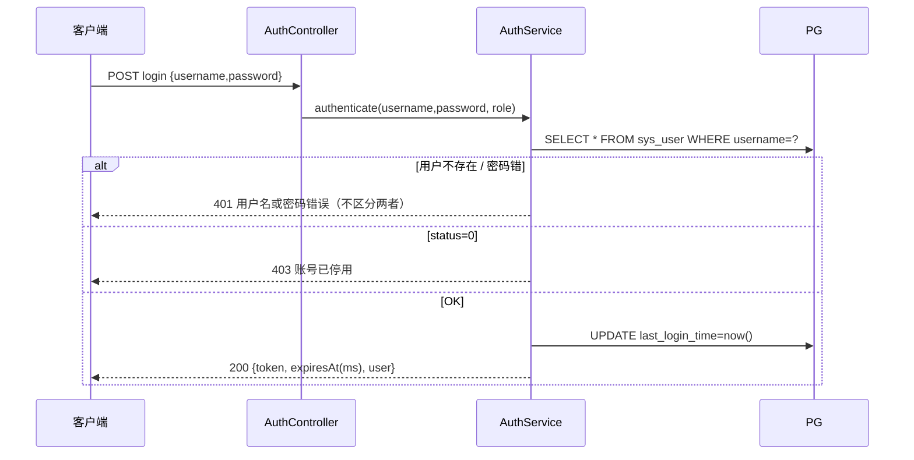

# 20 · 后端工程详细设计（Spring Boot）

> 隶属：[PLAN.md](../../PLAN.md) · 版本 v1.2 · 对应里程碑：M1 主链路（§6~§9）+ M3 OpenList 数据源（§12）+ M4 刮削（§13，暂缓）
> v1.2（2026-10-10）：§3 目录树同步 M3 实际落地（`scrape/` 源管理包 + SourceController；PlayUrlService 在 app/service）
> v1.1（2026-10-09）：§3 工程目录更新为 M1 实际结构（域包平铺 + dashboard 包）
> 前置文档：[10-data-model.md](./10-data-model.md)（表结构以此为准）、[30-api-contract.md](./30-api-contract.md)（接口字段以此为准）

---

## 1. 范围

本文覆盖 `server/` 工程全部：Maven 依赖、目录分包、配置、公共层（响应/错误码/异常）、鉴权链路、TV 端服务、后台服务、缓存与并发、OpenList 客户端、刮削引擎、安全与可观测、测试用例。接口字段不重复定义，以 30 契约为准。

---

## 2. Maven 依赖（`server/pom.xml`）

```xml
<parent>spring-boot-starter-parent 3.3.x</parent>
<java>17</java>
```

| 依赖 | 版本 | 用途 |
|---|---|---|
| `spring-boot-starter-web` | 3.3.x | MVC + Tomcat |
| `spring-boot-starter-validation` | 3.3.x | JSR-380 参数校验 |
| `mybatis-plus-spring-boot3-starter` | 3.5.9+ | ORM（**SB3 必须 spring-boot3 变体**） |
| `mybatis-plus-jsqlparser` | 同 3.5.9+ | 分页等 jsqlparser 插件（**3.5.9 起移出 core，必须显式引入**） |
| `org.postgresql:postgresql` | 42.7.x | PG 驱动（运行时） |
| `lombok` | 随 BOM | `provided` |
| `io.jsonwebtoken:jjwt-api / jjwt-impl / jjwt-jackson` | 0.12.6 | JWT（impl/jackson 运行时） |
| `org.springframework.security:spring-security-crypto` | 6.x | **仅用 BCryptPasswordEncoder**，不引入 security 全家桶 |
| `com.github.ben-manes.caffeine:caffeine` | 3.1.x | 本地缓存 |
| `springdoc-openapi-starter-webmvc-ui` | 2.6.x | Swagger（**仅 dev profile**，prod 关闭） |
| `spring-boot-starter-test` | 3.3.x | 测试（含 JUnit5/Mockito） |

> 不引入 spring-boot-starter-security、fastjson、Redis。JSON 用 Boot 默认 Jackson（`JavaTimeModule` 禁用：时间一律 long 毫秒，在 DTO 里就用 `Long`）。

---

## 3. 工程目录

> 结构约定：实体/DTO/Mapper/Service 按域包平铺；`app`/`admin` 只放 controller（+ TV 端 model）。
> M3 实际结构（2026-10-10 起以此为准）：OpenList 源管理（CRUD + 连通性测试 + Token 加密）落在 `scrape/` 域包 + `admin.controller.SourceController`；播放地址组装在 `app.service.PlayUrlService`。文件刮削引擎/候选审核（`scrape.client/engine/parse`）保留 M4。

```
server/
├─ pom.xml
├─ sql/
│  ├─ schema.sql                 # 建表（顺序：source 先于 movie）
│  └─ seed.sql
└─ src/
   ├─ main/java/com/hypermux/server/
   │  ├─ HyperMuxServerApplication.java   # @MapperScan
   │  ├─ common/
   │  │  ├─ R.java                        # 统一响应 R<T>{code,msg,data}
   │  │  ├─ PageResult.java               # {list,total,page,size}
   │  │  ├─ IdResult.java                 # 写操作通用 {id}
   │  │  ├─ Ts.java                       # OffsetDateTime → 毫秒时间戳
   │  │  ├─ ErrorCode.java                # 错误码枚举（见 §7）
   │  │  ├─ BizException.java             # 可选携带 data（409 提示用）
   │  │  ├─ GlobalExceptionHandler.java   # @RestControllerAdvice
   │  │  ├─ TraceFilter.java              # MDC trace + X-Trace-Id
   │  │  ├─ WebConfig.java                # MVC 拦截器注册 / 静态资源 / OpenAPI profile
   │  │  ├─ MybatisPlusConfig.java        # 分页插件 + MetaObjectHandler 时间填充
   │  │  └─ crypto/ AesGcmCipher.java     # Token 加密（AES-256-GCM）
   │  ├─ auth/
   │  │  ├─ JwtProperties.java            # @ConfigurationProperties("hypermux.jwt")
   │  │  ├─ JwtTokenService.java          # 签发/解析（jjwt 0.12 API）
   │  │  ├─ AuthInterceptor.java          # 前缀路由 + role 拦截 + 放入 UserContext
   │  │  ├─ UserContext.java              # ThreadLocal<LoginUser{userId,role,username}>
   │  │  ├─ AuthService.java              # 登录 + BCrypt + 失败限流
   │  │  └─ LoginReq / SessionVo / TokenCipherProperties / MigrateProperties
   │  ├─ app/                              # ─────── TV 端 ───────
   │  │  ├─ controller/ AppAuthController | AppHomeController | AppMovieController
   │  │  │             AppPlayController  | AppHistoryController
   │  │  ├─ service/   HomeService | MovieQueryService（可见性铁律唯一实现）
   │  │  │             PlayUrlService | ProgressService
   │  │  └─ model/     TV 端 req/vo 记录（HomeVo, TvMovieCard, TvMovieDetail,
   │  │                TvSeasons, PlayUrlReq/Vo, ProgressReportReq,
   │  │                FinishReq, TvHistoryItem, TvProgressLite/TvProgress…）
   │  ├─ admin/                            # ─────── 后台（只有 controller，service 在域包）───────
   │  │  └─ controller/ AdminAuthController | DashboardController
   │  │               | PoolController | MovieController | VideoController
   │  │               | TagController | UserController | SourceController（M3）
   │  │               | （M4，暂缓）ScrapeTaskController | CandidateController
   │  ├─ pool/      PoolEntity | PoolMapper | PoolService | PoolVo
   │  │              PoolSaveReq | PoolUpdateReq | PoolDeleteResult | PoolVisibleCount
   │  ├─ tag/       TagEntity | TagMapper | TagService | TagVo | TagListVo
   │  │              TagSaveReq | TagUpdateReq | TagDeleteResult | TagMovieCount
   │  ├─ user/      SysUserEntity | UserMapper | UserService | UserVo
   │  │              UserSaveReq | UserUpdateReq | ResetPasswordReq/Result | UserDeleteResult
   │  ├─ movie/     MovieEntity | MovieMapper | MovieTagMapper | MovieService
   │  │              MovieTagRow | MovieTagPair | MovieListVo | MovieDetailVo
   │  │              MovieSaveReq | MovieUpdateReq | EpisodeReq | TagRef
   │  │              MovieCreateResult | MovieDeleteResult | StatusResult | SourceCountRow
   │  ├─ video/     VideoEntity | VideoMapper | VideoService | VideoUrlUtil
   │  │              VideoVo | VideoListVo | EpisodeEditReq | VideosReplaceReq
   │  │              VideoImportReq | ImportResult | ReplaceResult | VideoCountRow
   │  ├─ progress/  PlayProgressEntity | ProgressMapper（home 继续看/历史联表 SQL 内置）
   │  ├─ dashboard/ DashboardService | DashboardVo | RecentTaskVo
   │  ├─ scrape/    OpenListSourceEntity | SourceMapper | SourceService
   │  │              OpenListClient（version + fs/list 两步探测/测试连通）
   │  │              OpenListProperties | ScrapeProperties
   │  │              SourceSaveReq | SourceUpdateReq | SourceVo | SourceListVo
   │  │              TestResult | SourceDeleteResult
   │  │              ScrapeTaskEntity | TaskMapper（M4，暂缓：client/parse/engine 子包）
   │  └─ migrate/   SchemaMigrateRunner.java  # 启动自动迁移 + admin bootstrap
   └─ main/resources/
     ├─ application.yml
     ├─ application-dev.yml        # gitignore（局域网 DB 凭据）
     ├─ sql/                       # 规范 DDL/seed（UTF-8，启动自动执行）
     └─ static/                    # admin 构建产物（同源部署）
```

实体类（`*Entity.java`）与各域 Mapper/Service **同包平铺**（不建 `model/` 子目录），`@TableName` + `@TableId(type=IdType.AUTO)`，`createTime/updateTime` 用 `@TableField(fill=INSERT / INSERT_UPDATE)` 由 `MetaObjectHandler` 填充，**禁止手写**。VO/Req 一律 Java record。M4 的 `scrape/` 子包（client/parse/engine/config）落地时按 §12 展开。

---

## 4. 配置（`application.yml` 全量）

```yaml
server:
  port: 8080
spring:
  application: { name: hypermux-server }
  datasource:
    url: jdbc:postgresql://${PG_HOST:127.0.0.1}:${PG_PORT:5432}/${PG_DB:hypermux}
    username: ${PG_USER:hypermux}
    password: ${PG_PASSWORD:hypermux}
    hikari: { maximum-pool-size: 10, minimum-idle: 2 }
  web:
    resources:
      static-locations: classpath:/static/
mybatis-plus:
  configuration:
    map-underscore-to-camel-case: true
    log-impl: org.apache.ibatis.logging.nologging.NoLoggingImpl
  global-config:
    db-config: { id-type: auto, logic-delete-field: "" }   # 不做逻辑删
hypermux:
  jwt:
    secret: ${JWT_SECRET:}      # ≥32 字符，env 注入；启动校验为空则 fail-fast
    app-ttl: 7d                  # TV 端 token
    admin-ttl: 12h               # 后台 token
  crypto:
    token-key: ${HYPERMUX_SECRET:}   # 32 字节，OpenList token 加密密钥，env 注入
  openlist:
    connect-timeout-ms: 5000
    read-timeout-ms: 30000
    retries: 1
    page-size: 100
  scrape:
    max-depth: 8                 # 遍历深度上限
    max-dirs: 20000              # 目录数硬顶（防误配根盘）
    dir-concurrency: 4           # 同层目录并发拉取
    batch-size: 2000             # 落库批大小
    task-timeout-min: 30         # 任务总超时
  swagger:
    enabled: ${SWAGGER_ENABLED:false}   # dev profile 置 true
```

`@ConfigurationProperties` 装配：`JwtProperties` / `TokenCipherProperties` / `OpenListProperties` / `ScrapeProperties`，启动期 Assert 非空（`secret`、`token-key`）。

---

## 5. 公共层约定

### 5.1 统一响应与分页

```java
public record R<T>(int code, String msg, T data) {
  public static <T> R<T> ok(T d) { return new R<>(0, "ok", d); }
  public static R<Void> fail(ErrorCode ec, String detail) { return new R<>(ec.code(), ec.msg() + (detail==null?"":"：" + detail), null); }
}
// PageResult<T>: { List<T> list; long total; int page; int size; }
```

### 5.2 时间序列化

- 所有 VO 中时间字段统一 `Long`（**毫秒时间戳**）；实体层 `timestamptz` 映射 `OffsetDateTime`，`Mapstruct`/手工转 `toInstant().toEpochMilli()`。
- Jackson 配置：`WRITE_DATES_AS_TIMESTAMPS=false` 不影响（我们不用 Date 出入）。

### 5.3 参数校验

- Controller 入参 `@Valid` + JSR-380（`@NotBlank/@NotNull/@Size/@Pattern/@Min/@Max`）；`MethodArgumentNotValidException` → 400，`msg` 取第一条字段错误（`字段名: 信息`）。
- 路径参数不存在 → 服务层抛 `BizException(NOT_FOUND, "影片不存在: {id}")`。

### 5.4 MyBatis-Plus 配置

`MybatisPlusConfig`：`MybatisPlusInterceptor` + `PaginationInnerInterceptor(DbType.POSTGRE_SQL)`（`maxLimit=100`）；`OptimisticLockerInnerInterceptor` **不加**（无乐观锁场景）。

---

## 6. 鉴权链路

### 6.1 设计

- 单一 `AuthInterceptor`（`HandlerInterceptor`），按前缀路由：

| 前缀 | 要求 | 401 语义 |
|---|---|---|
| `/api/app/auth/login` | 无 | - |
| `/api/app/**` | token payload `role==0` | token 缺失/过期/无效；role 不符→403 |
| `/api/admin/auth/login` | 无 | - |
| `/api/admin/**` | token payload `role==1` | 同上 |
| 其他（`/`, `/swagger-ui/**`, static） | 无 | - |

- `AuthInterceptor.preHandle`：解析 → 查 `sys_user`（**每请求查库，_status 停用即时生效_**，200 池+本地无缓存，必要时加 Caffeine 30s）→ 失败：未激活/已删 → 401；停用（status=0）→ 403 `账号已停用`；role 不符 → 403。
- 通过后写 `UserContext`（ThreadLocal），`afterCompletion` 清理。业务层一切 user id 从 `UserContext` 取，**不信前端传的 userId**。

### 6.2 JwtTokenService（jjwt 0.12）

```
payload: sub=userId, uname, role, iat, exp
密钥: HMAC-SHA256(secret)
签发: 登录时 app-ttl / admin-ttl
解析: try-catch 全流程 → ExpiredJwtException→401"登录已过期" / 其他→401"token 无效"
```

### 6.3 登录流程



- App 与 Admin 各一个端点，共用 `authenticate(username, password, expectRole)`；App 登录失败 5 次/分钟 → 429 `尝试太频繁`（Caffeine 计数器，防爆破）。
- 密码：`BCryptPasswordEncoder(10)`；重置密码明文只在响应里返回一次。

### 6.4 安全底线

- 存量 token 无法即时吊销（无 Redis/黑名单）：接受最长 admin 12h / app 7d 窗口；**停用用户因每请求查库即失效**（重要保护）。
- 登录接口防连猜：429 + 5/min/username。

---

## 7. 错误码表（全局）

| code | HTTP | 语义 | 触发示例 |
|---|---|---|---|
| 0 | 200 | 成功 | - |
| 400 | 400 | 参数/业务校验失败 | 参数缺失、发布缺 pool/封面、URL 格式错 |
| 401 | 401 | 未认证 | token 缺失/过期/无效、用户名或密码错误 |
| 403 | 403 | 无权限/账号停用 | role 不符、账号停用、删最后管理员 |
| 404 | 404 | 资源不存在 | movie/video/user/task id 不存在 |
| 409 | 409 | 冲突 | 用户名/池名/标签名重复、同池重名、非法状态流转、源有关联禁止删 |
| 423 | 423 | 源忙：已有 RUNNING 刮削任务 | 重复发起刮削 |
| 429 | 429 | 限流 | 登录 5 次/分钟 |
| 500 | 500 | 系统内部错误 | 未捕获异常（GlobalExceptionHandler 兜底，日志含 stack） |

约定：**业务码 = HTTP 状态码**（客户端看 `code` 或 status 二选一即可）；`GlobalExceptionHandler` 映射：`BizException→其 code`、`MethodArgumentNotValidException→400`、`HttpMessageNotReadable→400`、`DataIntegrityViolation(23505)→409`、`DataAccessException→500`（log.error）、其他→500。

---

## 8. TV 端服务（`/api/app/*`，M1）

### 8.1 MovieQueryService（只读，唯一实现 TV 可见性）

所有查询带可见性过滤（**集中在此，杜绝散落**）：

```sql
-- 池内影片列表（分页）
SELECT m.*, p.name pool_name FROM movie m JOIN pool p ON p.id=m.pool_id
WHERE p.status=1 AND m.status='PUBLISHED' AND m.pool_id=? 
  [AND (m.title ILIKE '%kw%' OR (m.original_title ~~* %kw%))]
ORDER BY m.sort_no, m.id LIMIT ? OFFSET ?   -- count(*) 同条件

-- 详情：movie 一行 + tags（movie_tag join tag）+ myProgress(user_id, movie_id)
-- 剧集：SELECT v.* FROM video v WHERE movie_id=? AND missing=0
       ORDER BY season_no, episode_no;
       同时 SELECT video_id, position_ms, duration_ms, finished FROM play_progress
             WHERE user_id=? AND video_id IN (...)   -- 一次 IN，无 N+1
```

- 影片列表出参 `progress` 合并：`SELECT * FROM play_progress WHERE user_id=? AND finished=0 AND movie_id IN (本页ids)` 一次 IN。
- 列表页 **不** 返回 `intro`（详情才给），控制首页包体。

### 8.2 HomeService（`GET /api/app/home`）

```
data = {
  pools: [ {id,name,coverUrl,movieCount} ]        -- pool.status=1，movieCount=PUBLISHED 计数（缓存见 §9）
  continueWatching: [ {movieId,title,coverUrl,poolName,
                       lastVideo:{id,seasonNo,episodeNo}, positionMs, durationMs} ×10 ]
}
```
`continueWatching`：`play_progress finished=0 ORDER BY update_time DESC LIMIT 10` join movie（仅 PUBLISHED，被下架后自动从继续观看消失）。

### 8.3 PlayUrlService（`POST /api/app/play-url`）

```
video.missing=1 → 404 "该资源暂不可用"
OPENLIST:
  source = sourceMapper.selectById(video.sourceId 的 movie)   // 经 movie.source_id
  url = source.serverUrl + "/d/" + encodePath(video.openlist_path)
  // encodePath: 按 / 分段逐段 URLEncoder.encode(seg, UTF_8)，段间保留 /
  headers: 默认空；如配置源级 referer 则附带
REMOTE: url = video.remoteUrl
返回 {url, headers, expiresAt: null}
```
- 源被停用（status=0）仍允许播放（历史片源容忍），仅源被物理删（source_id 置空）时报 404。
- **M5 可选**：`sign+exp` 附加参数（`?sign=HMAC(path|exp)&exp=`），客户端不感知。

### 8.4 ProgressService

- `PUT /api/app/progress`：video 必须存在且 `movie.status='PUBLISHED'`（否则 404）→ 10-data.sql §4 的 upsert（≥总量-30s 自动 finished=1）。
- `POST /api/app/progress/finish`：无记录 → 404；有 → `finished=1`（或 position 置尾）。
- `GET /api/app/history`：`play_progress` join movie join video，`ORDER BY update_time DESC LIMIT ?`（默认 20，max 50）；只含 movie 可见（被删影片自动消失）。

---

## 9. 后台服务（`/api/admin/*`，M1）

| Service | 规则要点 |
|---|---|
| `PoolService` | CRUD + `movieCount` 统计列；**有影片禁止删（409）**；改名 409 兜底 |
| `MovieService` | 创建=校验+直接 PUBLISHED（episode_total 由 episodes 计算）；编辑主信息（含 tagIds 全量替换，事务）；publish（DRAFT→PUBLISHED 校验 pool+cover+非missing集≥1）；offline；delete（任意状态级联）；列表筛选 status/poolId/keyword（含 DRAFT——候选页另走 CandidateService） |
| `VideoService` | `GET` 列表（含 missing 标记）；`PUT /videos` **全量替换**（事务：先校验 id 归属、(season,episode) 重复→409、url_kind 推导：`http(s)://` 开头→REMOTE 否则 OPENLIST；DELETE not-in + 批量 upsert；回写 movie.episode_total）；`POST /videos/import` 粘贴导入：逐行解析 `N,url` 或裸 url（季内序号从 max+1 续），返回 `{added,updated,errors[{line,msg}]}`（校验失败行跳过不炸整体） |
| `TagService` | CRUD；删除=cascade 解绑（不 409）；列表带 `movieCount` |
| `UserService` | CRUD（username 正则 `^[a-zA-Z0-9_]{3,32}$` 全局唯一）；重置密码（可指定或随机 8 位，返回明文一次）；**禁止停用/删除自己、禁止删到 0 个启用管理员（409）** |
| `CandidateService` | DRAFT 的视图与流转：列表（带 sourceName/posterCandidates/episodeSample 前 3 集名/解析置信标记）；编辑（主字段 + `coverUrl` 支持直接填 posterCandidates 中任一）；`publish`（单/批量，逐条校验，失败项收集不中断）；`ignore`（DRAFT 物理删） |
| `SourceService` | CRUD（创建时 `test()` 连通性探测失败→400 提示）；`test`：`GET /api/fs/list path=/` 验 token + 返回 `version?`（`/api/public/version` 有则取）；**禁用=改 status=0；硬删仅当关联 movie=0**；token 写库前 `AesGcmCipher.encrypt`，出参恒不出 |
| `ScrapeTaskController`（薄） | 创建/查询/停止委托 `ScrapeTaskService` |
| `DashboardController` | `GET /api/admin/dashboard`：pools/published/draft/users/runningTasks + 最近 5 任务（简单聚合 SQL，M3 实现） |

**事务边界**：一个写请求一个 `@Transactional`（MovieService 的"主信息+tags"、VideoService 全量替换必须同事务）；**刮削引擎的批量落库每 batch 一个事务**（§13）。

**关键保护**：刮削引擎**永不覆盖**人工已填字段（title/original_title/year/cover_url/rating/area/intro/pool_id/tagIds），只写：`source_path` 锚定、`scrape_assets`、剧集行（新增/指纹刷 size&fingerprint&missing/季集号修正仅当该 (s,e) 行为刮削新建时）。冲突判定：`update_time` 晚于任务开始时间且 `source_type='MANUAL'` 的字段不碰（简化实现：引擎根本不 SELECT 这些字段做写，UPDATE 语句白名单列）。

---

## 10. 缓存（M5 正式启用，M1 预留接口）

| 缓存 | TTL/失效 | 内容 |
|---|---|---|
| `poolSummaryCache` | Caffeine 5min + 写失效 | pool 列表 + movieCount（home 用） |
| `homeCache` | Caffeine 1min，按 userId 分 key（max 1024） | home 聚合 JSON |
| 用户状态 | Caffeine 30s | Auth 每请求查库的体验优化（停用 ≤30s 生效） |

失效触发：pool/movie 任何写 → `CacheHolder.invalidate("pools","home")` 全清（home 按 user 全清，成本可接受）。**不引入 Redis**：单进程足够；如未来多实例，homeCache 退化关闭即可。

---

## 11. 并发与线程

| 项 | 设计 |
|---|---|
| 刮削线程池 | `@Bean ScrapeExecutor`：core 2 / max 4 / queue 8 / `CallerRuns` 拒绝（超了排队执行，不丢任务）；引擎内目录并发另用 `dir-concurrency=4` 的 `Semaphore`+ `CompletableFuture` |
| 源级互斥 | `ScrapeTaskService.start()`：`ConcurrentHashMap<Long sourceId, Long runningTaskId>` tryLock；成功则插 task 行 `PUT RUNNING`，失败 423。**双保险**：DB 层 `SELECT count(*) FROM scrape_task WHERE source_id=? AND status IN ('RUNNING','STOPPING')` 复查（多实例安全） |
| 停止 | `stop()`：DB 置 `STOPPING` + `ConcurrentHashMap<Long,AtomicBoolean> stopFlags` 置位；引擎每处理 1 个目录 / 每 2s 检查 flag → 优雅收尾已遍历部分，落 `STOPPED`（已落库的候选保留） |
| 服务重启恢复 | `ApplicationReadyEvent` 监听：`UPDATE scrape_task SET status='FAILED', error='server restart interrupted', end_time=now() WHERE status IN ('RUNNING','STOPPING')`；清内存锁 |
| 任务总超时 | 引擎 `task-timeout-min=30` 到点按 FAILED 收口（防 OpenList 半死不活挂死） |
| 手动 CRUD 与刮削并发 | 允许：引擎写列白名单（§9 保护），人工字段无覆盖风险；`video` 唯一键冲突 → 引擎 `ON CONFLICT DO UPDATE`（只刷自己的列） |

---

## 12. OpenListClient（`scrape/client`）

```java
public interface OpenListClient {
   FsPage listDir(String serverUrl, String token, String path, int page); // GET /api/fs/list?path=&page=&per_page=200
   String ping(String serverUrl);                    // GET /api/public/settings（免鉴权）→ version 或 null
   String login(String serverUrl, String user, String pass, String otp); // POST /api/auth/login 账密换 token（建源向导）
   String fetchFile(String serverUrl, String relPath); // GET /d/<逐段encode> 读取小文件（NFO ≤1MB，失败 null）
   static String encodeSegments(String path);        // 直链编码（30-api §4.8，与 PlayUrlService 同口径）
}
```

- 基于 JDK11 `java.net.http.HttpClient`（不引 OkHttp 依赖，连接池由 HttpClient 管），超时取 `OpenListProperties`。
- **真实 OpenList v4（4.1.8 实机+源码核对，非 alist v3）**：
  - `GET /api/public/settings` 免鉴权 → `{code:200, data:{version}}`；用于 `ping`/建源探测。
  - `GET /api/fs/list?path=&page=&per_page=200`，Header `Authorization: <裸 token>`（**无 Bearer 前缀**）。
  - `POST /api/auth/login` 账密换 token：body `{username, password, otp_code?}` → `{code:200, data:{token}}`；
    密码错/需验证码或 2FA → HTTP 200 + body `code!=200`，归一抛 `OpenListException(UPSTREAM, 透传 message)`（POST 单次不重试）。
- 响应约定（v4）：**错误也返回 HTTP 200**，一律以 body `code` 判定：200 成功；401 `token is invalidated`；403 `Guest user is disabled`；404 `file not found`。`code!=200` → `OpenListException(msg + 映射错误码)`。
- `FsEntry{name, path（绝对路径）, size, modified(RFC3339→ms), dir}`；`dir` 以 `is_dir` 为准（`type==1` 仅兜底）。上游条目缺 `path` 字段时（部分网盘挂载 123pan/夸克等），以「请求父路径 + name」经 `joinPath` 兜底拼绝对路径——向导浏览与引擎 BFS 均直接依赖该字段。分页：`content.size() < per_page` 即到底（`hasMore = page*perPage < total && entries.size() >= perPage`）。
- 错误映射：401→`INVALID_TOKEN`；IOException/timeout/上游 5xx → `NETWORK`（含地址）；其余 → `UPSTREAM`。重试：仅 NETWORK 类，`retries` 次（默认 1），间隔 1s。
- `fetchFile`：拼 `{serverUrl}/d/<encodeSegments(relPath)>`，best-effort（非 200/异常/>1MB → null）——刮削期只读 NFO 文本，不传视频体。
- 遍历不走递归 HTTP 栈：引擎 BFS 队列（§13），目录并发 `dir-concurrency=4`。
- **建源向导会话（`OpenListSessionVault`）**：`POST /api/admin/openlist/session` 三种凭据（apiToken / 账密 login 结果 / sourceId 解密已存 token）统一收敛为服务端内存会话（UUID sessionId，**TTL 30min 用后续期**，容量 64 超限淘汰最旧，重启失效）；
  `POST /openlist/session/{id}/list` 据会话列目录。**明文 token（含账密换取值）永不出参**；上游错误统一 400 透传文案（401/403/404 不占 401——那是管理员登录态语义）。

**与旧草稿的差异（实锤修正）**：早期文档的 `/api/v3/public/version` + `code==0` 为 alist v3 口径，**不存在于 OpenList v4**；M4 按 v4 实现（本表为准，30-api §4.8 同步修正）。

---

## 13. ScrapeEngine（★ 重点，M4）

### 13.1 执行流程（`scrape(sourceId, type, operatorId)`）

```
 1. ScrapeTaskService.start() 拿锁 → INSERT scrape_task(RUNNING)
 2. @Async ScrapeEngine.execute(task, source)：
    ┌ BFS：level=刮削范围种子 ScrapeScope.seeds(root, include_paths)（范围空=[root_path]；
    │        非空=选中子树各一：去重 + 剔除被祖先覆盖者，全部越界 → FAILED 零写入）
    │  visited=set，depth=0（自种子起算），目录并发 dir-concurrency=4
    │  每层并发 fetchAllPages（按页循环，stopFlag/超时按页检查）
    │    files: 命中 ext 白名单 且 不含 ignore 模式 且 不含隐藏前缀(. ) → 入 filmFiles(dir→[FsEntry])
    │    dirs:  depth+1 ≤ max-depth 入队（visited 防环；ignore 命中的目录整棵跳过、不枚举不计 scanned）
    │    scannedDirs++（仅实际 LIST 成功的目录；每 10 目录或 2s touch 一次 task.scanned）
    │    stopFlag/超时检查
    └ 遍历结束
 3. 识别（MatchRuleA/B，仅产 CandidateFilm 内存对象）：
    A: 每个“含 ≥1 媒体文件的目录”= 1 影片；其子目录若含 Sxx 名 → 展开为季
    B: root 一级目录 = 1 影片；二级 Sxx 目录 = 季（二级不是季号则当普通目录并入）
       A 与 B 的差异(B)：影片目录本身不放媒体时 A 不识别、B 识别
 4. 命名解析（parse 包）：
    - 影片名：目录名去后缀 → MovieNameParser（§13.3）
    - 季集：EpisodeNameParser 降级链（§13.4）；整影片无解析 → 全 1 季按自然序
    - 海报：目录内 *.jpg|png|webp 且 名含 poster|cover|folder|banner|thumb 取 ≤3 → scrape_assets.posterPaths；NFO（仅新片）→ fill originalTitle/year/rating/intro
 5. diff（对照 DB 该 source 存量）：
    - 影片锚点 movie(source_id, source_path)：
       命中 → 复用（保留人工字段）
       未命中 → INSERT movie DRAFT（source_type=SCRAPE, scrape_assets, title=解析名, year）
       source.auto_publish=1 → 转 PUBLISHED（pool_id=源的默认池?——见 13.5）
    - 文件锚点 openlist_path：
       命中 video → fingerprint 变? update size/fingerprint/missing=0 : ignore
       未命中 → 定 (s,e)（解析或季内空槽续号）→ INSERT video（唯一键冲突按 13.6 补偿，savepoint 事务内重试）
    - 存量 video.openlist_path 不在本次遍历集 → missing=1, remove_count++
       （FULL 模式下存量行 media 全 missing 且 auto_off? → 不做自动下架，仅任务页提示）
 6. 落库：按影片逐片事务（1 影片 1 tx，movie 先插、video 后插保 FK）；每片后累计 task 计数
 7. 收尾：movie.episode_total 重算（COUNT non-missing）
    task → FINISHED/STOPPED（优雅停止，已扫部分照常落库、不做 missing 标记）+ end_time + 汇总；source.last_scrape_at=now
    异常: task → FAILED(error=trunc1k)；source.last_error
    finally: 释放内存锁/stopFlag；log.info 汇总行
```

**刮削范围（`openlist_source.include_paths`，建源向导第 3 步）**：
- 保存时经 `ScrapeScope.validate`：归一化（前导 `/`、去尾 `/`）→ 每项须等于 `root_path` 或在其之下 → 拒绝 `.`/`..` 独立段 → 去重、≤200 项、单项 ≤255 字符，违规 400。
- 引擎扫描种子 = `ScrapeScope.seeds`：范围空 → `[root]`（**兼容既有"未划范围=全刮"**）；非空 → 每个选中子树一个种子（字典序去重、祖先覆盖后代剔除——防子树列两遍导致媒体重复入库）；全越界（如手改 DB）→ 任务 FAILED `刮削范围无效（须在根目录之下）`，零写入。
- **范围外的存量影片完全不受本次任务影响**：不在种子子树 → 不进 byMovie → 既不 diff 也不参与 missing 判定（缩范围不会误删数据）；范围内照常按上表 diff。

### 13.2 识别规则配置（挂在 source 上）

| 参数 | 默认 | 说明 |
|---|---|---|
| `match_mode` | A | A: 含媒体目录=影片（支持 Sxx 季目录展开）；B: 一级目录=影片+Sxx 季目录 |
| `ext_whitelist` | mkv,mp4,avi,ts,flv,m4v,mov,wmv | 逗号分隔 |
| `ignore_patterns` | sample,Sample,样本,.part,.!qB,aria2 | **文件名子串** 匹配；目录名命中则整目录跳过（进 visited 标记但文件的旁路） |
| 隐藏文件 | 硬编码 | 名以 `.` 开头且非 nfo/poster 类 → 跳过 |
| MAX | | `max-depth=8`（目录层数，自 root 起）、`max-dirs=20000` 超顶 → task FAILED `目录数超顶` |

### 13.3 MovieNameParser（正则表）

| # | 正则（java，`Pattern`） | 例子 → 结果 |
|---|---|---|
| 1 | `^(?<title>.+?)[\s_]*[（(](?<year>19\d{2}|20\d{2})[)）]\s*$` | `狂飙 (2023)` → title=狂飙 year=2023 |
| 2 | `^(?<title>.+?)[\s_]+(?<year>19\d{2}|20\d{2})\s*$` | `Oppenheimer 2023.mkv` → title=Oppenheimer year=2023（单文件电影也走同解析） |
| 3 | 裸目录名 | `Friends` → title=Friends year=null |
- 解析前预处理：去 `.mkv` 等白名单扩展名、去 `-1080p/-2160p/HEVC/BluRay/x265/HDR` 质量尾缀（仅用于 title 展示，`source_file` 留原样）。
- 结果置信：命中 1/2 → `parsed=true`（审核页绿点），3 → `parsed=false`（橙点"建议核对"）。

### 13.4 EpisodeNameParser 降级链

| 优先级 | 规则 | 例子 → (s,e) | parsed |
|---|---|---|---|
| 1 | `S{1,2}(\d{1,2})(?!\d)[._ \t-]*E{1,2}(\d{1,3})(?!\d)`（CI） | `x.S01E02.mkv` → (1,2) | true |
| 2 | `第\s*([0-9一二三四五六七八九十]{1,3})\s*季.*?第\s*([0-9一二三四五六七八九十]{1,3})\s*集` | `老友记.第二季.第1集` → (2,1)（中文数字→阿拉伯） | true |
| 3 | `第\s*([0-9一二三四五六七八九十]{1,3})\s*集` | `狂飙.第3集.mkv` → (缺省季,3)（"零"不映射） | true |
| 4 | 首个独立数字段（1~999；紧邻 `S/s` 的段视为季号跳过，`E` 前缀允许） | `狂飙.E03.mkv` → (缺省,3) | **false** |
| 5 | 兜底：自然排序（`Collator`+数字段感）按顺序编 1..N，季=目录 Sxx 号或 1 | 全部不上号的文件 | false |

- 预处理（每次 parse）：去扩展名 → `QualitySuffix.strip` 剥质量尾缀（**完整 token + 分隔符边界**才剥，如 `1080p/2160p/4K/BluRay/WEBRip/x264/x265/HEVC/HDR/REMUX`；`E1080` 不剥），并清掉切割点残留尾分隔符（` \t._-`；括号仅在不破坏配对时剥，保住 `(1999)` 年份括号）。
- 数值合法域：`s≤99`、`e≤999`，越界视该规则未命中继续降级（自然序不受限）。
- **猜号口径**：R4/R5 的文件计入 `scrape_assets.unparsedEpisodes`；候选 `parsed = nameParsed && unparsedEpisodes==0`（审核页"只看集数猜的"= `?unparsed=true`，30-api §4.10）。
- 自然序补号：同季内按自然序取**第一个空槽**（占用集合以 `seasonKey=s*1000+e` 组合键计，保证 S1/S2 互不串号）。

**季号解析**：所属目录名 `S{1,2}\d`（CI）或 `第X季` 命中则整目录统一 season=s（就近季目录，取 `(影片目录, 文件目录]` 链上最近者），否则 season=1。
冲突（同影片已存在 (s,e) 不同文件）：见 13.6。

### 13.5 auto_publish 源

`auto_publish=1` 的源刮出的影片直接 PUBLISHED：
- 需要 `pool_id`：source 增加配置列？——**复用决策：auto_publish 源必须同时填 `root_path` 所属池约定**，为避免加字段，约定：auto_publish 源刮削前（SourceService 校验）自动 create-or-reuse 一个名为 `__auto_<sourceId>` 的隐藏池（`status=1, sort_no=9999`），影片归入该池；审核页不出现 DRAFT，结果直接在影片列表看。（实现简化，文档锁定此约定。）

### 13.6 (season,episode) 占用冲突策略

文件 F 解析出 (s,e) 已被影片 M 的既有 video V 占用（或同任务内先插的文件占用）：
1. 内存占用集 `occupied`（既有 video 的 `seasonKey(s,e)=s*1000+e` + 本任务已分配键）命中 → **追加补偿集号**：同季从 `max(该季已用)+1` 起找第一个空槽，`log.warn` 记录原文件名与新旧集号——保证不丢文件；
2. 兜底（脏数据/并发漏网）：DB 唯一键 `uk_video_mov_season_ep` 冲突时补偿重试（最多 2 次），**重试必须包在 savepoint（PROPAGATION_NESTED）事务内**——PG 下一语句失败即 abort 整个外层事务，裸重试只会得到 25P02；
3. 同 openlist_path 已存在的 video：只刷新 fingerprint/size/missing（幂等），不重分配集号。

### 13.7 幂等/断点保证

- 全量重跑 = 空 visited 重建，diff 基于 DB 锚点 → 结果与首跑一致（零新增，仅 missing 纠正）。
- 崩溃恢复：已落库部分合法（批事务），未落库部分无痕迹；task 由启动钩子置 FAILED；重跑增量安全。
- 与人工写并发：引擎 UPDATE 语句**固定列白名单**（见 §9），唯一键冲突 `ON CONFLICT DO UPDATE`（仅 size/fingerprint/missing/update_time）。

### 13.8 性能预算

- 200 影片 / 20000 文件目录：`dir-concurrency=4` 下遍历 ~3~8min（OpenList 50~200ms/页 经验值）；`scanned` 进度 ≥ 每 2s 可感。
- 单影片 4K × 100g 不影响（只读元数据，不传文件体）。

---

## 14. 安全与可观测

- **入参安全**：URL/路径全走参数化（MyBatis-Plus 自带）；日志不打 token/密码。
- **静态资源**：`static/` 目录（admin 构建物）由 WebConfig 映射，`/api/**` 永不落静态；`.git` 类不入库（构建产物，`resources/static` 加 `.gitignore`，构建时 rsync 进去——或 CI 直接输出）。
- **请求摘要日志**：Filter 输出 `[api] uid=.. role=.. GET /api/app/home 200 35ms`（不 log body）。
- **慢查询**：HikariCP leakDetectionThreshold + MyBatis 超时默认 10s；M5 开 `p6spy` 仅 dev。
- **异常出口**：GlobalExceptionHandler 统一 JSON；5xx 必 log.error（含 trace id：MDC 加 `traceId` = 短 UUID，入响应 header `X-Trace-Id` 便于排障）。
- **优雅停机**：`server.shutdown=graceful` + `lifecycle.timeout-per-shutdown-phase=20s`；停机时 RUNNING task → FAILED（同启动钩子逻辑的 ApplicationEvent）。

---

## 15. 测试用例清单（M1/M4 各一组关键项）

**M1（单元+接口冒烟）**
1. 登录：错密码 401 不泄露用户存在性；停用 403；admin 调 /api/app 403；app 调 /api/admin 403。
2. movie 创建：同池重名 409；缺 episode 400；创建后 TV 端可见性通过。
3. video 全量替换：提交 3 条含 1 条原 id → 删 1 增 2 改 1；(s,e) 重复 409。
4. 断点 upsert：重复 (user,video) 行数恒 1；position≥duration-30s 自动 finished。
5. play-url：OPENLIST path 含中文/空格 → 正确 percent-encode；REMOTE 原样。
6. TV 可见性：DRAFT/OFF/pool 停用/missing 全不可见（4 个参数化用例）。

**M4（解析器 UT + diff 集成）**
7. `EpisodeNameParser` 用例表：`S01E02`/`s01 e02`/`第3集`/`第二季第1集`/`EP004`/`04.mkv`/乱序 `7,3,10` → 自然序 → 期望 (s,e) 序列（≥15 case）。
8. `MovieNameParser`：中英文括号、无年份、带扩展名、质量尾缀（≥8 case）。
9. diff 三态：新增影片 / 已存在影片加新集 / 文件消失 missing=1 / 文件重现 missing=0 且指纹刷新（集成，H2 跑不了 → 用 testcontainers PG，或 M5 前可本地起 PG 跑 `@SpringBootTest`）。
10. 幂等：同目录连跑两次 → 第二次 new=0、update=0、remove=0。
11. 互斥：连续两次 start → 第二次 423；stop 后 state=STOPPED（或 ≤2s）。
12. 崩溃恢复：启动时 RUNNING 任务全部 FAILED（模拟：启动前直插 RUNNING 行）。

---

## 16. 任务分解（给排期用）

**M1（4–5d）**
- D1：骨架 + schema/seed + 公共层（R/错误码/异常/MP 配置）+ Jwt + Auth 拦截 + 两个 login
- D2：pool/tag/user 三域 CRUD（后台接口全）
- D3：movie CRUD + video 全量替换/导入 + 发布下架
- D4：TV 端 9 接口（home/列表/详情/剧集/play-url/progress×3）+ 可见性 UT
- D5：admin 静态挂载验证 + dashboard + 冒烟联调（curl 全接口）+ 文档交 M3 用

**M4（5–7d）**
- D1：OpenListClient + ping + 对真实 OpenList 冒烟（**风险最高，优先做**）
- D2：Source CRUD/test + 互斥与任务框架（task 表 CRUD/停止/恢复钩子）
- D3：Parser 两则 UT 全绿 + MatchRuleA/B
- D4：Engine BFS + diff + 落库批量 + 进度写
- D5：CandidateService + 候选 4 接口 + auto_publish 池约定
- D6：联调（真实目录 200 片）+ 幂等/冲突/停止用例
- D7：缓冲 + 性能（20000 文件）
