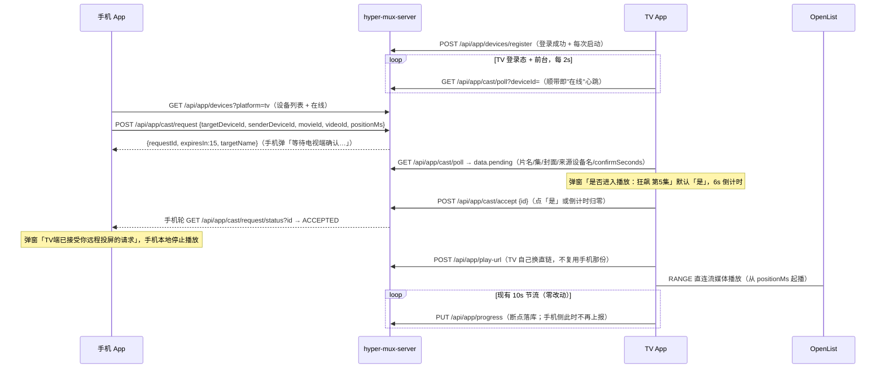

# 80 · 远程投屏详细设计（手机端 → TV 端）

> 隶属：[PLAN.md](../../PLAN.md) §2.1 / 里程碑 **M7 远程投屏** · 版本 v1.0（2026-10-22）
> 关联文档：[10-data-model](./10-data-model.md)（v1.3 新增两张表） / [30-api-contract](./30-api-contract.md)（v1.7 新增 §3.13） / [20-backend-detailed](./20-backend-detailed.md)（分包补 `cast/`） / [45-phone-app-detailed](./45-phone-app-detailed.md)（手机端投屏章节）
> **本文档是投屏功能的唯一事实源。改结构先改本文档 + schema.sql，再改代码。**

---

## 1. 范围与口径（锁定）

**一句话**：同一账号下，手机把「正在看/选中的那一集」投送到 TV 上播放；服务器只做指令中转，**不中转视频流**（TV 自己向服务端换 OpenList 直链，沿用 §5.5 直连铁律）。

**流程口径（不可偏离）**：

1. 手机端与 TV 端**必须登录同一账号**（`role=0` 普通用户）。
2. 手机端发起投屏 → 服务器接收指令并转发给 TV 端。
3. TV 收到后**弹窗**：`接收到来自手机端的投屏请求` / `是否进入播放：{片名} 第{N}集`，**默认焦点在「是」，倒计时 6 秒，超时自动选「是」**；选「是」→ TV 进入播放页起播（从手机当前位置续播）。
4. TV 接受成功后，**手机端弹窗**：`TV端已接受你远程投屏的请求`。
5. **手机端不做遥控器**：手机只是"能远程投送的设备"。本期没有播放/暂停/seek/选集/音量遥控面板，没有 TV 播放状态回显。

**本期做**：手机 → TV 单向投送 + TV 确认弹窗 + 手机取消投屏 + 设备注册与在线状态 + 管理后台开关。
**本期不做（明确 Out of Scope）**：遥控器、屏幕镜像、多路并发投屏、TV 后台常驻接收。（手机 → Web / 手机 → Windows / 手机 → 手机 三种接收端已全部实现，见 §9.5 / §9.6 / §9.7。）

**并发模型**：**单并发 = 每账号同时只允许 1 路投屏**（最多 1 条 `PENDING`；新请求抢占旧请求）。

---

## 2. 术语

| 术语 | 含义 |
|---|---|
| 发送端 / sender | 发起投屏的手机设备（`platform=mobile`） |
| 目标端 / target | 接收投屏的 TV 设备（`platform=tv`） |
| 设备身份 `deviceId` | 客户端**安装级** UUID（4 端各自生成、落 DataStore），服务端只按 `(user_id, device_id)` 认设备 |
| 在线 online | 该设备最近 30s 内调过 `devices/register` 或 `cast/poll`（内存 Caffeine 判定，**不落库**） |
| 投屏请求 cast_request | 一次投送动作的生命周期记录（PENDING → 终态），不是长连接会话 |

---

## 3. 传输选型：短周期轮询（本期）

| 方案 | 结论 | 理由 |
|---|---|---|
| **轮询（选定）** | ✅ 本期 | 仓库已有同构模式：TV 扫码登录每 2s 轮 `GET /api/app/auth/qr/status`（[QrLoginService](../../hyper-mux-server/src/main/java/com/hypermux/server/auth/QrLoginService.java)）。本期语义 = 一次性请求 + TV 弹窗确认 + 手机取结果，与它完全同构。**零新增 Maven 依赖、零异步/SSE 配置、零换票、零 CORS/流式/Nginx buffering 处理**，鉴权继续走现有 `Authorization: Bearer`（秘密不进 URL），curl 就能全测 |
| SSE（`SseEmitter`） | ⏭ 二期升级 | 需要 `spring.mvc.async.request-timeout`、一次性 ticket 换票（EventSource 不能带 Header）、心跳与 emitter 生命周期管理、反代 `proxy_buffering off`。本期语义用不上双向/实时 |
| WebSocket / STOMP | ❌ | 需新增 `spring-boot-starter-websocket` + 握手鉴权改造，收益仅是双向 |
| 局域网 mDNS/NSD + 设备内置 HTTP | ❌ | 跨网段不可用、Web 端无法监听端口、Android 11+ 后台常驻受限；与"远程投屏"语义冲突 |

**代价**：投屏请求到达 TV 的延迟 ≤ 2s（TV 轮询周期）。弹窗场景可接受。

### 3.1 端到端时序



---

## 4. 数据模型（schema.sql 追加，幂等）

```sql
-- ============ 账号设备（投屏目标注册表） ============
CREATE TABLE IF NOT EXISTS user_device (
  id          bigserial PRIMARY KEY,
  user_id     int8 NOT NULL REFERENCES sys_user(id) ON DELETE CASCADE,
  device_id   varchar(64) NOT NULL,               -- 客户端安装级 UUID
  platform    varchar(16) NOT NULL,               -- mobile / tv / web / windows（与 app_release 平台口径一致）
  device_name varchar(64),                        -- 客户端上报，服务端截断 64 + 清洗控制字符
  last_seen   timestamptz,
  create_time timestamptz NOT NULL DEFAULT now(),
  update_time timestamptz NOT NULL DEFAULT now(),
  UNIQUE (user_id, device_id)
);
CREATE INDEX IF NOT EXISTS idx_device_user ON user_device (user_id, platform);

-- ============ 投屏请求（单并发：每账号最多 1 条 PENDING） ============
CREATE TABLE IF NOT EXISTS cast_request (
  id               bigserial PRIMARY KEY,
  user_id          int8 NOT NULL REFERENCES sys_user(id) ON DELETE CASCADE,
  sender_device_id varchar(64) NOT NULL,
  target_device_id varchar(64) NOT NULL,
  sender_name      varchar(64),
  target_name      varchar(64),
  movie_id         int8 NOT NULL,
  video_id         int8 NOT NULL,
  movie_title      varchar(191) NOT NULL,         -- 发起时快照：TV 弹窗直接用，不再多跑一次接口
  episode_label    varchar(64),                   -- "第5集" 或 video.title
  cover_url        text,
  position_ms      int8 NOT NULL DEFAULT 0,       -- 手机当前进度；从详情页发起则取服务端断点或 0
  status           varchar(16) NOT NULL DEFAULT 'PENDING',
      -- PENDING / ACCEPTED / REJECTED / EXPIRED / CANCELLED / CLOSED
  expire_time      timestamptz NOT NULL,          -- create_time + request-ttl（15s）
  decided_time     timestamptz,
  closed_time      timestamptz,
  end_reason       varchar(32),                   -- user-yes / countdown / user-no / sender-cancel / preempted / timeout / tv-exit / idle
  create_time      timestamptz NOT NULL DEFAULT now(),
  update_time      timestamptz NOT NULL DEFAULT now()
);
CREATE UNIQUE INDEX IF NOT EXISTS uk_cast_pending_user ON cast_request (user_id) WHERE status = 'PENDING';
CREATE INDEX IF NOT EXISTS idx_cast_target_status ON cast_request (target_device_id, status, create_time DESC);
CREATE INDEX IF NOT EXISTS idx_cast_user_time     ON cast_request (user_id, create_time DESC);
```

**为什么 `movie_title/episode_label/cover_url` 落库快照**：TV 轮询命中后必须立刻能渲染弹窗文案，不能再发一次详情请求（多一次往返 + 可见性重复校验）；同时投屏记录本身是审计数据，片名快照让"我的/后台"列表自解释。

**为什么在线不落库**：与 [10-data-model §6.6](./10-data-model.md)「无 Redis：单进程 + Caffeine 足够」一致；`last_seen` 只用于"上次在线"展示，且落库节流 30s（poll 每 2s 一次，不能每 poll 写库）。

---

## 5. 状态机与单并发

```
（无）→ PENDING ─┬─ ACCEPTED ─┬─ CLOSED（被新请求抢占 / accepted-ttl 兜底 / 接收端退出播放）
                 │            └─（终态，历史记录）
                 ├─ REJECTED   （接收端点「否」/ BACK / 关闭弹窗）
                 ├─ EXPIRED    （expire_time 到期仍无人应答：接收端崩溃 / 未在前台）
                 └─ CANCELLED  （手机点「取消」 / 被同账号新请求抢占）
```

| 迁移 | 触发 | `end_reason` | 谁看到 |
|---|---|---|---|
| → PENDING | `POST cast/request` 成功 | — | 目标接收端（TV 或网页端，下一次 poll） |
| PENDING → ACCEPTED | `POST cast/accept`（点「是」或倒计时归零） | `user-yes` / `countdown` | 手机（status 轮询）→ 弹「{目标名} 已接受你远程投屏的请求」 |
| PENDING → REJECTED | `POST cast/reject` | `user-no` | 手机 → 弹「目标端已拒绝投屏请求」 |
| PENDING → EXPIRED | 清扫任务发现 `expire_time < now()` | `timeout` | 手机 → 弹「目标端未响应，请稍后重试」 |
| PENDING → CANCELLED | 手机 `POST cast/cancel` | `sender-cancel` | 目标接收端（poll 的 `cancelledIds`）→ 关闭弹窗 |
| PENDING → CANCELLED | 同账号新请求抢占 | `preempted` | 旧目标接收端（`cancelledIds`）→ 关闭弹窗 |
| ACCEPTED → CLOSED | 新请求抢占旧投屏 | `preempted` | 旧目标接收端（`cancelledIds`）→ **停止播放回上一页** + 提示「已被其他设备接管」 |
| ACCEPTED → CLOSED | 接收端退出播放页 | `tv-exit`（TV）/ `web-exit`（网页端）/ `desktop-exit`（电脑端）/ `mobile-exit`（接收端手机） | 手机（`cast/current` 变 null）→ 「已投送至」卡消失 |
| ACCEPTED → CLOSED | `accepted-ttl`（3h）兜底 | `idle` | 无提示（历史记录） |

**单并发强制（两层）**：
1. 服务层：`POST cast/request` 先 `closeActive(userId, "preempted")` —— 把该账号当前 PENDING/ACCEPTED 记录置终态，并把旧 `target_device_id` 记入"待通知"集合（旧目标 poll 时收到 `cancelledIds`）。
2. DB 兜底：部分唯一索引 `uk_cast_pending_user`；并发撞索引 → `DataIntegrityViolationException` → 409（[GlobalExceptionHandler](../../hyper-mux-server/src/main/java/com/hypermux/server/common/GlobalExceptionHandler.java) 已统一转 409）。

**过期判定必须按落库 `expire_time`**，不能按"缓存被 poll 续期"——这是 [QrLoginService](../../hyper-mux-server/src/main/java/com/hypermux/server/auth/QrLoginService.java) 注释里已经踩过的坑（TV 每 2s 轮询会把 Caffeine TTL 无限续命）。

---

## 6. 接口契约（同步写入 [30-api-contract §3.13](./30-api-contract.md)）

全部端点需 `role=0` 普通用户 Bearer token，**无匿名端点**；`user_id` 一律取 token，绝不接受请求体传入。

| 方法 | 路径 | 说明 |
|---|---|---|
| POST | `/api/app/devices/register` | `{deviceId, platform, deviceName}` → 幂等 upsert，`data={deviceId}` |
| GET | `/api/app/devices?platform=tv` | `data=[{deviceId, platform, deviceName, online, lastSeen, casting}]`（platform 可空 = 全部；手机端投屏列表取全部再本地过滤，只排掉本机自己） |
| POST | `/api/app/cast/request` | `{targetDeviceId, senderDeviceId, movieId, videoId, positionMs?}` → `data={requestId, expiresIn, targetName}` |
| GET | `/api/app/cast/request/status?id=` | 手机 1s 轮询（≤17s）：`data={id, status, targetName, endReason}` |
| GET | `/api/app/cast/poll?deviceId=` | **接收端 2s 轮询**（TV / 网页端）：`data={pending: CastPendingVo\|null, cancelledIds: long[], confirmSeconds}` |
| POST | `/api/app/cast/accept` | `{id}` → `data={id, movieId, videoId, positionMs, movieTitle, episodeLabel}` |
| POST | `/api/app/cast/reject` | `{id}` → `data=true` |
| POST | `/api/app/cast/cancel` | `{id}` → `data=true`（幂等） |
| GET | `/api/app/cast/current` | `data={active: CastBriefVo\|null}`（**壳对象恒非空**，见 30-api-contract §3.13 的包壳理由） |
| GET | `/api/app/cast/config` | `data={enabled, confirmSeconds, requestTtlSeconds, pollIntervalMs}`（两端投屏入口打开时各取一次） |

`CastPendingVo`：`{id, senderDeviceId, senderName, movieId, videoId, movieTitle, episodeLabel, coverUrl, positionMs, expireTime, confirmSeconds}`
`CastBriefVo`：`{id, status, senderDeviceId, targetDeviceId, senderName, targetName, movieId, videoId, movieTitle, episodeLabel, coverUrl, positionMs, startedTime}`

**`cancelledIds` 的语义**：服务端只保留"该设备最近 `hypermux.cast.notify-window`（默认 2 分钟）内被终态化为 `CANCELLED`/`CLOSED`、且 `notified_at IS NULL`"的请求 id（PENDING 被 cancel/preempt、ACCEPTED 被 preempt），每轮 `poll` 最多取 10 条，**取到即置 `notified_at`**（一次性下发，不会每 2s 重发）。TV 收到后：若弹窗正显示该 id → 关闭弹窗；若正在播放该请求带来的集 → 停止播放回上一页并提示。

> 实现注记：`config` 独立端点而非塞进 `GET /api/app/home`，避免为下发一个开关去改三端（手机/TV/Web）的 `HomeVo` 模型。

---

## 7. 后端实现分解（`com.hypermux.server.cast`）

| 文件 | 职责 |
|---|---|
| `cast/UserDeviceEntity.java` + `cast/UserDeviceMapper.java` | MyBatis-Plus 实体/Mapper（照 `PlayProgressEntity` 的 `@Data @TableName @TableId(AUTO)` 风格） |
| `cast/CastRequestEntity.java` + `cast/CastRequestMapper.java` | 状态/原因常量 + `findByIdAndUser` / `findActiveForUser`（PENDING 优先）/ `listActiveForUser` / `findPendingForTarget(…, expire_time > now)` / `listActiveTargetIds` / `listToNotify`（`notified_at IS NULL` 窗口取 10 条）/ `expirePending(now)` / `closeStaleAccepted(now, before)` |
| `cast/CastVos.java` | record DTO（风格同 `TvVos`）：`RegisterReq / DeviceIdVo / DeviceVo / RequestReq / RequestedVo / StatusVo / PendingVo / PollVo / AcceptReq / AcceptedVo / IdReq / CurrentVo / CastBriefVo / ConfigVo` |
| `cast/CastProperties.java` | `@ConfigurationProperties("hypermux.cast")`（入口类已有 `@ConfigurationPropertiesScan`，无需注册） |
| `cast/DevicePresenceService.java` | Caffeine `userId:deviceId → lastSeenAt`（TTL 30s）；`touch()`（含 `last_seen` 落库节流 30s）/ `isOnline()` |
| `cast/CastService.java` | 生命周期与校验（见 §7.2） |
| `cast/CastSweeper.java` | `@Scheduled(fixedDelay=10_000)`：PENDING 过期 → `EXPIRED(timeout)`；ACCEPTED 超 `accepted-ttl` → `CLOSED(idle)`（入口类已有 `@EnableScheduling`） |
| `app/controller/AppDeviceController.java` | `/api/app/devices` |
| `app/controller/AppCastController.java` | `/api/app/cast/**` |

### 7.1 配置

```yaml
hypermux:
  cast:
    enabled: ${HYPERMUX_CAST_ENABLED:true}
    request-ttl: 15s            # 手机轮询上限 = 该值 + 2s
    accepted-ttl: 3h            # ACCEPTED 记录自动 CLOSED 的兜底（整季连播也可能超过 30min，故给到 3h）
    confirm-seconds: 6          # TV 弹窗倒计时（管理后台可覆盖 3~15）
    poll-min-interval-ms: 1000  # 服务端限频护栏（低于此的 poll → 429）
    notify-window: 2m           # cancelledIds 的下发窗口：只回看 2 分钟内被终态化的记录
```

> `closeStaleAccepted` 把超 `accepted-ttl` 的记录置 `CLOSED(idle)` 时**同时置 `notified_at = now`**：这类"服务端自己判定的超时收尾"不该被下发成 `cancelledIds`，否则会让一台其实还在正常播放的 TV 收到"停止"信号。

`sys_config` 的 `cast_enabled` / `cast_confirm_seconds` **覆盖** yml 默认值（运行时可关，不用重启）。
`pom.xml` 与 `WebConfig.java` **无需改动**。

### 7.2 校验顺序（`POST cast/request`）

1. `enabled`（sys_config 覆盖 yml）→ 否则 409 `投屏功能已关闭`
2. `deviceId/platform` 合法性：`platform ∈ {mobile,tv,web,windows}`，`deviceId` 非空 ≤64 → 否则 400
3. `senderDeviceId == targetDeviceId` → 400 `不能投屏到本设备`
4. 目标设备存在且属于当前 user（`user_device` 按 `(user_id, device_id)` 查）→ 否则 **404 `设备不存在`**（不区分"不存在/不属于你"，避免枚举）
5. 目标平台不再设限：`register` 时 `normalizePlatform` 已把 `platform` 收敛成 `mobile/tv/web/windows` 四个值，所以 `user_device` 里的目标必然是四端之一 —— **接收端 = 全部四端（含手机端）**，`cast/request` 不再按平台拒绝任何目标
6. 目标在线（`DevicePresenceService.isOnline`）→ 否则 409 `目标端不在线，请先在电视 / 网页端 / 电脑端 / 手机端打开 HyperMux`
7. 发送设备同样必须已在 `(user_id, sender_device_id)` 注册（否则 400 `发送设备未注册，请先在本机登录一次`）
8. 影片可见性：复用 [MovieQueryService.requireVisible](../../hyper-mux-server/src/main/java/com/hypermux/server/app/service/MovieQueryService.java)（404）；`video` 必须存在、`movie_id` 匹配、`missing=0`（404 `剧集不存在或文件已丢失`）
9. 片名/集名/封面快照：`episode_label = video.title ?: "第" + episodeNo + "集"`（有季号时 `第S季 第N集`）
10. 抢占：`preemptActive(userId)` —— 旧 PENDING → `CANCELLED(preempted)`、旧 ACCEPTED → `CLOSED(preempted)`，并给旧目标留一条待下发的 `cancelledIds`
11. 插入 PENDING（`expire_time = now + request-ttl`）；撞 `uk_cast_pending_user` → 409 `已有投屏请求待确认，请稍候再试`

`accept`：按 `(id, user_id)` 取；不存在 → 404；`status != PENDING` → 409 `该投屏请求已结束`；`expire_time < now` → 先置 `EXPIRED(timeout)` 再 409。置 `ACCEPTED` + `decided_time` + `end_reason`（客户端传 `reason=countdown|user-yes`，缺省 `user-yes`）。

`reject` / `cancel`：幂等 —— 已是终态直接 `data=true`（客户端不关心第二次结果）；PENDING 才写 `end_reason`。

`poll`：按 `(user_id, target_device_id, status='PENDING', expire_time > now)` 取最新一条 → `pending`；再取该设备 `notify-window`（默认 2 分钟）内被终态化且 `notified_at IS NULL` 的 id 列表（最多 10 条）→ `cancelledIds`，取到即置 `notified_at`（一次性下发，避免每 2s 重发）；顺带 `touch()` 在线状态；限频护栏（同设备两次 poll < `poll-min-interval-ms` → 429）。**投屏功能关闭时返回 200 + 空 `pending`**，不报 409。

---

## 8. 手机端规格（`hyper-mux-android`，包名 `com.hypermux.mobile`）

### 8.1 设备身份

- 新增 `data/repo/DeviceRepo.kt`（独立 DataStore `name = "device"`，不塞进 `SettingsRepo`：设备身份与用户偏好是两回事）：`device_id`（首次访问 `UUID.randomUUID()` 落盘，之后只读）、`device_name`（默认 `手机 · ${Build.MODEL}`，「我的」页可改，≤64）、`cast_last_target`（上次成功投屏的 TV deviceId，弹层据此高亮）。
- 注册时机：`AppNavigation` 的 `LaunchedEffect(session != null)`（登录成功与启动恢复会话都走这里）+ 打开投屏设备弹层 + 进入「我的」页，各调一次 `devices/register`（幂等，顺带刷在线）。登出时 `CastState.clear()`，不把上一账号的投屏状态带过去。

### 8.2 新增文件

| 文件 | 内容 |
|---|---|
| `data/repo/DeviceRepo.kt` | deviceId 生成/读取、设备名读写、`registerSelf()/registerSelfAsync()`、`listTvDevices()`、`lastCastTarget()/setLastCastTarget()` |
| `data/cast/CastState.kt` | **`@Singleton` 投屏状态机**：`active / waiting / outcome / enabled` 四个 StateFlow + `send()` / `startPolling()`（1s 轮 `request/status`，上限 17s）/ `cancelActive()` / `restore()` / `clear()`；`isCasting` 供播放页闸门读 |
| `data/api/ApiService.kt`（改） | 追加 8 个方法（§6 1:1）+ `registerDevice` / `castDevices` |
| `data/model/Models.kt`（改） | `CastRegisterReq / CastDeviceIdVo / CastDeviceVo / CastRequestReq / CastRequestedVo / CastStatusVo / CastIdReq / CastCurrentVo(active 可空) / CastBriefVo / CastConfigVo` |
| `config/AppConfig.kt`（改） | `CAST_POLL_INTERVAL_MS = 1_000L`、`CAST_POLL_MAX_MS = 17_000L` |
| `ui/cast/CastViewModel.kt` | 薄壳：把 `CastState` + `DeviceRepo` 暴露给各页面（设备列表 / 本机名 / 发起 / 取消） |
| `ui/cast/CastDeviceSheet.kt` | 设备选择底部弹层（`HyperBottomSheet`） |
| `ui/cast/CastStatusDialog.kt` | 等待态 + 五态结果弹窗（`HyperDialog`） |
| `ui/cast/CastUi.kt` | `CastButton`（控制条按钮，样式照 `CacheButton`）、`CastSentOverlay`（投屏生效后的手机侧状态卡）、`CastActiveChip` |
| `ui/player/PlayerIcons.kt`（改） | 自绘 `Cast` 图标（圆角屏幕框 + 两段信号弧 + 圆头端点） |

> `CastState` 是 `@Singleton`：播放页、详情页、「我的」页各自的 `CastViewModel` 实例读同一份状态，切页不会丢投屏状态，也不需要把 VM 提到 Activity 作用域。

### 8.3 交互与状态

```
点「投屏」→ CastDeviceSheet（列同账号 tv 设备）
  ├ 在线：可点，显示 deviceName + 绿点；上次成功目标默认高亮（DataStore cast_last_target）
  ├ 离线：灰显不可点 + 文案「离线 · 请先在电视上打开 HyperMux」+ 右上角「刷新」
  └ 空列表：「没有发现同账号的电视设备」
点设备 → POST cast/request → CastStatusDialog「正在等待「{TV名}」确认…」（带「取消投屏」）
  协程每 1s 轮 GET cast/request/status（上限 17s）
  ├ ACCEPTED → 弹窗「TV端已接受你远程投屏的请求」（单按钮「知道了」）
  │            同时：本地 player.playWhenReady=false + 播放区换成 CastSentOverlay（封面 + 片名 + 集 + 「取消投屏」）
  ├ REJECTED → 弹窗「TV端已拒绝投屏请求」
  ├ EXPIRED  → 弹窗「电视端未响应，请稍后重试」
  ├ CANCELLED（被其它设备接管 / 自己取消）→ 弹窗「已取消投屏」
  └ 连续 2 次轮询失败 → 弹窗「投屏失败：{服务端 msg}」
```

**投屏生效后的低频观察**：`active` 非空时 `CastState` 起一个 5s 一轮的 `cast/current` 观察协程，`active` 变 null 或状态进终态就清掉本地状态 —— 电视端退出播放页（`cast/cancel`）或被同账号新请求接管时，手机上的「已投送至 …」卡会在 ≤5s 内自己消失（没有推送通道，只能靠这一层低频确认）。

**不做遥控器**：投屏成功后手机没有任何播放控制控件，只有「取消投屏」。

### 8.4 改动既有文件

- `ui/player/PlayerScreen.kt`：`PortraitControlOverlay` 与 `LandscapeControls` 各加 `castOn / castEnabled / onCast` 三个参数与一个 `CastButton`（`castEnabled=false` 时按钮不出现）；投屏激活时播放区之上盖 `CastSentOverlay`、手势层 `enabled=false`；`LaunchedEffect(castActive)` 里 `playWhenReady=false`。
- `ui/player/PlayerViewModel.kt`：**投屏闸门** —— 注入 `CastState`，`isCasting` 时 `reportProgress()` 直接 return（避免与 TV 双写 `play_progress` 互相覆盖断点）；另暴露 `castActive` 给 UI。
- ~~`ui/movie/MovieDetailScreen.kt`~~：**详情页投屏入口已撤除**（实机反馈：详情页没有播放上下文，"从断点投过去"不如在播放页投顺手）。手机端投屏入口只保留播放页（竖屏控制条 + 横屏右上角簇）。
- `ui/me/MeScreen.kt`：「投屏」区 —— 本机设备名（可改）/ 本机设备号尾号 / 同账号投屏目标列表（电视 + 网页端，在线绿点·离线灰，点击刷新，另每 5s 自动刷新一次，只在「我的」页在前台时跑）。「当前投屏（可取消）」一行已撤除（投屏状态卡由播放页承载，Me 页重复）。
- `ui/navigation/AppNavigation.kt`：登录态确立时注册本机设备 + `restore()` + `refreshConfig()`；登出时 `clear()`。
- Manifest：**无需新权限**（`INTERNET` 已有）。

---

## 9. 接收端规格 A：TV 端（`hyper-mux-android-tv`，包名 `com.hypermux.tv`）

### 9.1 新增 / 改动文件

| 文件 | 内容 |
|---|---|
| `data/repo/DeviceRepo.kt`（新） | 独立 DataStore `name = "device"`：安装级 UUID、设备名（默认 `TV · ${Build.MODEL}`）、`registerSelf()`（platform=`tv`）、`listDevices()` |
| `data/cast/CastPollClient.kt`（新） | `@Singleton`；`start()/stop()` 协程循环，每 2s `GET cast/poll?deviceId=`；输出 `SharedFlow<CastIncoming>`（`Request(pending)` / `Cancelled(ids)` / `DeviceUnknown`）；`enabled / confirmSeconds / polling` 三个 StateFlow；404 → 注册一次本机设备，429/网络失败按 2s→4s→8s→15s 退避（不弹错误、不刷日志） |
| `ui/CastViewModel.kt`（新） | **Activity 作用域**（像 `AppNavigation` 里的 `UpdateViewModel`）：`pending / launch / activeCastId / stopRequested / notice` + `accept(reason) / reject() / cancelActiveCast(reason) / consume*()`；收到 `Cancelled(ids)` 命中当前投屏 → `stopRequested` 发一次性事件让播放页停止（用事件流而不是 StateFlow：不在播放页时收到就丢弃，不会污染下一次正常播放） |
| `ui/cast/CastConfirmDialog.kt`（新） | 确认弹窗（§9.2） |
| `data/api/ApiService.kt`（改） | `registerDevice / castDevices / castPoll / castAccept / castReject / castCancel / castConfig` |
| `data/model/Models.kt`（改） | `CastRegisterReq / CastDeviceIdVo / CastDeviceVo / CastPendingVo / CastPollVo / CastAcceptReq / CastAcceptedVo / CastIdReq / CastConfigVo` |
| `config/AppConfig.kt`（改） | `CAST_POLL_INTERVAL_MS = 2_000L`、`CAST_CONFIRM_COUNTDOWN_S = 6`（服务端 `confirmSeconds` 下发时以其为准） |
| `ui/navigation/Route.kt` + `NavComponents.kt`（改） | `Play` 路由加两个**带 defaultValue 的可选查询参数** `castResumeMs`（`LongType`，默认 `-1`）与 `castSender`（`StringType`，默认空）；新增 `navigatePlayCast(...)`。默认值让现有全部 `navigatePlay` 调用点一行都不用改 |
| `ui/navigation/AppNavigation.kt`（改） | 挂 `CastViewModel`；`DisposableEffect` + `LifecycleEventObserver` 让 poll **只在「已登录 + App 前台」时跑**；`launch` → `navigatePlayCast`；窗口层挂 `CastConfirmDialog`；`notice` 走 `TvMessageOverlay` |
| `ui/player/PlayerViewModel.kt`（改） | 从 `SavedStateHandle` 读 `castResumeMs / castSender`；`castResumeMs >= 0` 时**优先于**剧集 `progress` 推导的 `_resumeMs` |
| `ui/player/PlayerScreen.kt`（改） | 顶栏徽标 + 6s 一次性胶囊 + 退出时 `cast/cancel` + 收到 `stopRequested` 立刻 `reportNow()` 并退出播放页 |
| `ui/me/MeScreen.kt`（改） | 「远程投屏」区：投屏接收状态 / 本机设备名 / 设备号尾号（§9.4） |

### 9.2 确认弹窗规格（严格按流程口径）

- 挂载层：窗口层（与 `UpdateDialog` 同级），**不受 NavHost 切换打断**；TV 正在播放别的片子时弹窗覆盖在播放页之上。
- 标题：`接收到来自手机端的投屏请求`
- 正文：`是否进入播放：{movieTitle} {episodeLabel}`；副信息行：`来自 {senderName}`；左侧封面缩略图（`coverUrl`，缺省占位图）。
- 按钮：`是`（品牌绿 Primary，文案带倒计时 `是（6s）`）/ `否`（Secondary 描边）。TV 上不是 `bounceClick` 而是 `tvClickable`（焦点放大 + 描边）。
- **默认焦点在「是」的实现方式**：`HyperDialog` 自带 `TvAutoFocus` + `focusGroup`，焦点按布局顺序落在**行内第一个**可聚焦元素；`HyperDialog` 的行内顺序是 `dismissButton → confirmButton`，因此把「是」放进 `dismissButton` 槽（左）、「否」放进 `confirmButton` 槽（右）。左右/上下方向键在两个按钮间移动。
- 倒计时：`LinearProgressIndicator` 横条 + 文案「{n} 秒后自动播放（默认「是」，遥控器返回键 = 「否」）」，`n` 从 `confirmSeconds`（默认 6，取值 3~15）递减；归零 → 自动 `accept(reason=countdown)`。倒计时按 `pending.id` 记忆（`remember(pending.id)`）：同一请求在 PENDING 期间会被每轮 poll 重复下发，不能让弹窗每秒被重建、倒计时被重置（`CastViewModel` 也按 id 去重，两层都兜）。
- **`BACK` = 否**：`HyperDialog(dismissible=true)` 的 `onDismissRequest` 直接接 `reject()`；点弹窗外部同理。
- 视觉：走 `HyperDialog`（TV 大字号：标题 26sp / 正文 20sp），**不用系统 Toast**（电视上不可读）；`Text` 带 `heightIn` 时须包 `Box(contentAlignment=...)` 才垂直居中（AGENTS.md 约定）。
- 弹窗期间 TV 本地播放不受影响（选「否」原播放继续）。

### 9.3 接受后的播放链路

1. `POST cast/accept` → 拿 `{movieId, videoId, positionMs, movieTitle, episodeLabel}`。
2. `navController.navigatePlayCast(movieId, videoId, resumeMs=positionMs, senderName)`（`Play` 路由的两个可选查询参数 `castResumeMs` / `castSender` 都带 `defaultValue`，`launchSingleTop = true` 保证不会叠第二层播放页）。
3. `PlayerViewModel`：`SavedStateHandle` 里 `castResumeMs >= 0` 时**优先于**剧集 `progress` 推导的 `_resumeMs`（投屏位置就是用户在手机上看到的位置），并置 `isCastPlay = true`。
4. `PlayerScreen` 现有链路零改动：换直链 → seek → 起播 → 10s 节流断点上报 → 连播 → 离线待补报队列（`PendingProgressStore`）。**投屏产生的断点天然落 `play_progress`**，手机下次本地播放自动续上。
5. 可见反馈两处：进播放页 6s 的 `CaptionCapsule("投屏播放中 · 来自 {senderName}")`（顶部一次性轻提示）+ `TopInfoBar` 常驻徽标（UP 唤出顶栏时可见，绿色胶囊）。
6. 投屏播放中按 BACK 退出：走现有"双击返回防误触"流程，`exitPlayer()` 里 `vm.isCastPlay` → `POST cast/cancel`（`end_reason=tv-exit`）让手机端 ≤5s 内撤下「已投送至 …」卡。
7. 投屏播放中被手机端取消 / 被同账号新请求接管：`poll` 下发 `cancelledIds` → `CastViewModel.stopRequested`（一次性事件）→ `PlayerScreen` 立即 `reportNow()` + `popBackStack()`，并走 `TvMessageOverlay` 提示一句；不会"手机那边已经停了、电视还在播"。TV 自己 BACK 退出时已先清 `activeCastId`，因此不会给自己弹这条提示。

### 9.4 前置约束（写进 UI 文案）

TV 端必须**已登录 + App 在前台**才能收到投屏（poll 只在登录态 + 前台跑）。TV「我的」页投屏区显示「投屏接收：已开启（本电视在线）」及 deviceId 尾号，便于排查。

### 9.5 接收端规格 B：网页端（`hyper-mux-web`，Vue 3 + Vite）

语义与 §9.1–§9.4 一一对应，只把「TV App 在前台」换成「浏览器标签页在前台」：

| 文件 | 内容 |
|---|---|
| `src/stores/cast.ts`（新） | 设备身份 + 轮询 + 确认/取消，plain-module 风格（同 `stores/server.ts`）。`deviceId` 存 `localStorage['hypermux.web.deviceId']`：`crypto.randomUUID()`，**非安全上下文没有 randomUUID → 自带一段 v4 兜底**（`http://192.168.x.x:8080` 这类局域网直连必然走到）；`deviceName` 默认 `网页端 · <hostname>`；轮询用 `setTimeout` 链而不是 `setInterval`，好按错误类型退避：404 → 重注册、429 → ×2 ≤10s、其它 → ×2 ≤15s、401 → 停轮询等登录态 watcher 重启；`castPending` 按 `id` 去重（同一请求每轮重复下发，否则弹窗每秒重建）；`onCastStopped(fn)` 回调注册表 = 一次性事件，不用全局 ref（§9.3 第 7 条同一教训） |
| `src/components/CastConfirmDialog.vue`（新） | 确认弹窗：复用 `.dl-overlay` 遮罩 + `.dl-sheet` 面板；默认「是」，倒计时归零自动 `accept(countdown)`；「否」/ 点遮罩 / 关闭 / Esc = `reject(user-no)`，Enter = `accept(user-yes)`；倒计时按 `pending.id` 重置 |
| `src/App.vue`（改） | 挂 `CastConfirmDialog` 在壳层（任何页面都能弹，同 TV 的窗口层）；`initCastReceiver()` + `watch(user.isLoggedIn)` 驱动轮询；接受成功 → `router.push('/movie/{movieId}/play?videoId=&castPos=')` |
| `src/views/PlayView.vue`（改） | `castPos` 优先于该集服务端断点（**用完立刻从 query 抹掉**，否则切下一集会沿用上一集的秒数起播）；顶栏「投屏播放中」徽标 + 「结束投屏」按钮；`onBeforeUnmount` / 切影片 / 本集播完 → `cast/cancel(web-exit)`；`onCastStopped` → 停播回影片页 + 提示；确认弹窗在屏幕上时播放页快捷键让路 |
| `src/views/MeView.vue`（改） | 「投屏接收」区：本机设备名 / 设备号尾号 / 接收状态（监听中 · 每 2s / 未登录 / 页面在后台）+ 同账号电视与网页端设备列表（绿点在线，排除本机） |
| `src/api/index.ts` + `src/api/types.ts`（改） | `registerDevice / castPoll / castAccept / castReject / castCancel / getCastConfig / getCastDevices` + `CastPending / CastPollResult / CastAccepted / CastConfig / CastDevice` |

**轮询闸门 = 已登录 + `document.visibilityState === 'visible'`**：后台标签页空转会把这台浏览器一直标成在线，手机就能投到一个没人看的窗口（与 §9.4 同一口径）。

**与 TV 端的两处刻意差异**：

1. 网页端**能可靠地发 cancel**：离开播放页、切影片、本集播完都发 `cast/cancel(web-exit)`。TV 被直接杀进程时发不出 cancel，`ACCEPTED` 要等 `accepted-ttl`（3h）才 `CLOSED/idle`，这段时间手机端仍显示「已投送至」；网页端这条路径没有这个洞。
2. 网页端接受后**继续正常上报断点**（它自己就是播放端），不需要手机那种「投屏闸门」；手机侧闸门只针对手机本地播放。

**多标签页**：同一浏览器多个标签共享一个 `deviceId`（localStorage 同源共享）。两个标签都开轮询时 `pending` 会同时弹在两边、谁先 accept 谁播；`cancelledIds` 是一次性下发，只会被其中一个标签取走 —— 所以**同一浏览器多标签同时看片时投屏结果不确定**，UI 不承诺这种用法。

### 9.6 接收端规格 C：Windows 桌面端（`hyper-mux-windows`，Tauri v2 壳）

**不另写接收侧**：`tauri.conf.json` 的 `frontendDist` 直接指向 `../../hyper-mux-web/dist`，§9.5 的接收侧代码原样跑在 WebView2 里（确认弹窗、播放页徽标、被取消停播、「我的」页投屏接收区全都在）。桌面端只补三件浏览器做不到的事：

| 位置 | 内容 |
|---|---|
| `hyper-mux-web/src/stores/cast.ts` | `castPlatform()` = `isDesktop() ? 'windows' : 'web'`；默认设备名 `电脑端 · <计算机名>`；退出播放页的收尾原因改由 `TARGET_EXIT_REASON` 决定（桌面 `desktop-exit`、浏览器 `web-exit`），PlayView 不再硬写 `web-exit` |
| `hyper-mux-windows/src-tauri/src/lib.rs` | 新增 `device_label` 命令：读 `COMPUTERNAME`（回落 `HOSTNAME` / `NAME`，都没有回空串）。浏览器侧读不到计算机名，只能问 Rust 拿；`boot()` 里先 `await loadDesktopLabel()` 再注册，避免先注册成「电脑端」又改一次 |
| 服务端 `CastService` | §7.2 第 5 步放行 `windows`；`cancel` 的收尾原因白名单加 `desktop-exit`（`isTargetExitReason`） |

**播放走现有网页链路，不强制 mpv**：桌面壳本来就是 artplayer 在 WebView2 里播（mpv 只是解码兜底按钮），投屏接受后 `router.push('/movie/{id}/play?videoId=&castPos=')` 与网页端完全一致。§13 早期写的「Tauri 侧接受后走 mpv 播放」不成立，已按实际实现更正。

**在线语义**：轮询闸门仍是「已登录 + `document.visibilityState === 'visible'`」。WebView2 在窗口最小化 / 关到托盘时把页面置 hidden → 电脑端自动离线，手机端不会投到一台没人看的窗口；若某些 WebView2 版本不发这个事件，就退化成"窗口看不见但仍在轮询"，投屏照样起播（画面被最小化挡住）—— 这条按实测对待，不承诺。

**设备号**：桌面壳的 `localStorage['hypermux.web.deviceId']` 落在 WebView2 用户数据目录（`%LOCALAPPDATA%\com.hypermux.desktop\EBWebView`），跨启动稳定；卸载重装 = 新设备号（与 App 端同一语义）。

### 9.7 接收端规格 D：手机端（`hyper-mux-android`，"手机接手机"）

手机端从「只投送」变成**投送 + 接收双角色**。两条状态线刻意分开，不混用：

| 状态线 | 含义 | 对本地播放的要求 |
|---|---|---|
| `data/cast/CastState`（投送侧，已有） | 我投出去的，别人正在播 | 本机**停播**且不再上报断点 |
| `data/cast/CastReceiver`（接收侧，新增 `@Singleton`） | 别人投给我的，我正在播 | 本机**正常播放**并照常上报断点（10s 节流那套不变） |

同一账号服务端只留 1 条活跃请求，所以两者不会同时成立。

**角色判定（关键坑）**：`cast/current` 是按 **user_id** 查的，不按设备查。手机端开了接收侧之后，本机完全可能只是别人那条投屏的 target —— 原来的 `CastState.restore()` 会把它当成"我投出去的"，于是本机莫名停播并挂出「已投送至」胶囊。修法：`restore()` 只认 `senderDeviceId == 本机 deviceId` 的那一条（`senderDeviceId` 为空时按旧语义放行，兼容老服务端）；`startPolling` 里用 `castCurrent()` 补全展示字段时同样加 `id == 本次 requestId` 的校验。

**新增 / 改动文件**

| 文件 | 内容 |
|---|---|
| `data/cast/CastReceiver.kt` | 新增。轮询 `cast/poll`（2s）+ 事件处理 + `pending` / `launch` / `activeCastId` / `activeSender` / `stopRequested` / `notice` / `polling` / `confirmSeconds`。轮询节奏与错误分支照 TV 端 `CastPollClient`：404 → 注册一次继续、429 → 退避 ×2 ≤10s、其它 → ×2 ≤15s、401 交给 AuthInterceptor 只退避 |
| `ui/cast/CastConfirmDialog.kt` | 新增。`HyperDialog` 版确认窗：默认「是」，倒计时归零自动 `accept("countdown")`；「否」/ 蒙层 / 返回键 = `reject("user-no")`；倒计时按 `pending.id` 记忆，避免每轮轮询把弹窗重建 |
| `ui/cast/CastUi.kt` | 新增 `CastIncomingBadge`：播放区左上角一条半透明胶囊「投屏接收中 · 来自 X」+「结束投屏」；配色固定白色系（它只出现在视频浮层里） |
| `ui/cast/CastViewModel.kt` | 注入 `CastReceiver` 并把两条线的状态透出去。**状态必须留在单例**：播放页 / 「我的」页 / 导航壳各自 `hiltViewModel()` 拿到的是不同实例 |
| `ui/navigation/AppNavigation.kt` | 确认弹窗挂窗口层（与 TV 挂导航窗口层、网页端挂 `App.vue` 同一思路）；消费 `launch` → `navigatePlay`；轮询闸门 = 已登录 + `ON_RESUME`/`ON_STOP` 判定的 App 前台 |
| `ui/player/PlayerScreen.kt` | 徽标（竖屏与横屏两个分支都贴）；`stopRequested` → 停播 + `navigateUp`；`DisposableEffect.onDispose` → 离开播放页时 `cancelIncoming()`（服务端记 `mobile-exit`） |
| `ui/player/PlayerViewModel.kt` | 续播位置：投屏携带的 `positionMs` 优先于本机 progress 断点（与网页端 `castPos` 同一口径） |
| `data/repo/DeviceRepo.kt` | `listCastTargets()` 不再按平台过滤，只按 `deviceId != 本机` 排除自己 |
| `data/api/ApiService.kt`、`data/model/Models.kt` | 补 `cast/poll`、`cast/accept`、`cast/reject` 与 `CastPollVo` / `CastPendingVo` / `CastAcceptReq` / `CastAcceptedVo` |

**起播位置怎么传到播放页**：`Route.Play = "play/{movieId}/{videoId}"` 不加参数（避免动全部导航入口）。`CastReceiver` 在 accept 成功后存一条 `CastStartHint(movieId, videoId, positionMs, untilMs)`，`PlayerViewModel.loadMetadata()` 算完本机断点后调 `takeCastStartMs(movieId, videoId)` 覆盖 —— 命中才消费，15s 过期。之所以要过期：栈顶已是同一集时 `navigatePlay` 的 `launchSingleTop` 不会新建 `PlayerViewModel`，这条提示没人取用，不能留着让下次正常点开时被莫名 seek。

**结束投屏的两个入口**
- 徽标上的「结束投屏」：只 `cancel(mobile-exit)`，**本机继续播放**（与网页端 `endCast` 同一行为，发起端的「已投送至」胶囊立刻收掉）
- 直接离开播放页（返回键 / 切页）：`onDispose` 里补一次 `cancel(mobile-exit)`（与 TV 端 BACK 退出同一语义）

**在线语义**：轮询闸门 = 已登录 + App 在前台（`ON_RESUME` / `ON_STOP`）。退到后台 / 锁屏 → 停止轮询 → 30s 后本机在服务端标成离线，别的设备投不过来。这与 TV 端、网页端完全同一口径。

**「我的」页**：新增一行「投屏接收」，三态 —— `正在接收来自「X」的投屏` / `监听中 · 别的设备可投到本机` / `未监听 · App 在后台时不接收`，在线用品牌绿圆点。

---

## 10. 管理后台（`hyper-mux-admin` + `/api/admin/settings`）

- `SettingsService` / `AdminVos.SettingsVo` / `SettingsUpdateReq` 新增两键（走现有 `sys_config` + `ConfigService.put`）：
  - `castEnabled`（bool，默认 true）
  - `castConfirmSeconds`（int，3~15，默认 6）
- 系统设置页加「投屏」分组：`NSwitch`（远程投屏）+ `NInputNumber`（确认倒计时 3~15），文案「关闭后所有端不可投屏…」；`src/api/types.ts` 的 `SettingsVo` 同步加两字段。
- 保存后即时生效：`SettingsService` 写 `sys_config`，`CastService` 每次读配置时优先取 `sys_config`、缺失才回落到 `application.yml` 的 `hypermux.cast.*` —— **不用重启**。
- 本期未做（留二期）：用户详情页展示该用户最近投屏记录 `GET /api/admin/users/{id}/casts`（只读分页）。

---

## 11. 失败模式矩阵

| 场景 | 服务端行为 | 客户端表现 |
|---|---|---|
| 目标接收端离线（30s 内无 register/poll） | `cast/request` → 409 `目标端不在线，请先在电视 / 网页端 / 电脑端 / 手机端打开 HyperMux` | 设备弹层该设备灰显不可点；强行发起则弹该 msg |
| 目标 = 另一台手机（已开接收侧） | 与 TV / 网页端 / 电脑端同一套流程，无平台特例 | 目标手机弹确认窗（默认「是」）→ 接受后在目标手机上起播 |
| 目标设备属于别的账号 | 404 `设备不存在`（不区分"不存在/不属于你"） | 手机看不到对方设备（列表按 user 过滤） |
| `senderDeviceId == targetDeviceId` | 400 `不能投屏到本设备` | 手机设备列表不出现自己 |
| 影片 DRAFT/OFF/分类停用/`missing=1` | 404（复用可见性铁律） | 「影片不存在或已下架」 |
| 同账号已有 PENDING/ACCEPTED 再发起 | 抢占：旧 → `CANCELLED/CLOSED(preempted)` | 旧 TV 下一次 poll（≤2s）收到 `cancelledIds` → 关弹窗或停止播放并提示「投屏已结束：手机端已取消，或被同账号其它设备接管」；新 TV 正常弹窗 |
| 接收端未应答（崩溃/未前台）到 `expire_time` | 清扫 → `EXPIRED(timeout)` | 手机 ≤17s 内弹「目标端未响应，请稍后重试」 |
| 手机等待期间点「取消」 | `CANCELLED(sender-cancel)` | TV 若已弹出 → 下一次 poll 关闭弹窗、不起播 |
| 手机等待期间断网 | 请求失败 | 连续 2 次轮询失败 → 弹「投屏失败：{服务端 msg / 网络文案}」；服务端仍按 TTL 过期 |
| TV 双击「是」/点击与倒计时归零竞态 | 第一次生效，第二次 409 `该投屏请求已结束` | TV 吞 409（走提示层一句话），不重复起播 |
| `poll` 高频刷库 | `poll-min-interval-ms=1000` 护栏 → 429 | TV 忽略 429（继续正常周期轮询） |
| `castEnabled=false` | `cast/request` → 409 `投屏功能已关闭`；**`cast/poll` 返回 200 + 空 `pending`**（不报错，否则 TV 每 2s 弹一次错误）；`cast/config.enabled=false` | 两端投屏入口隐藏/禁用 |
| 直链时效 | TV 自己 `POST play-url`，不复用手机那份 URL/header | 避免跨端 header 串味与时效错配 |
| 断点双写 | 投屏被接受后手机闸门关闭上报 | TV 走现有 upsert（`uk_progress_user_video`） |
| 敏感信息 | 无 query 秘密（全走 Bearer）；设备名截断 64 + 控制字符清洗；`GlobalExceptionHandler` 只打 URI 不含 query | — |
| 多设备同投一台 TV | 单并发索引 + 抢占 | 同一时刻一台 TV 最多一个弹窗 |

---

## 12. 测试流程与预期结果（**由使用者在实机执行；本次交付不执行任何测试**）

> 判定口径统一：每条给出「操作 → 屏幕预期文案 → 可核对的 HTTP/DB 断言」。
> A 组只需 curl（不需要真机）；B 组需要真机 + 真服务器。
> curl 前置：后端已启动、库里有 1 部 `PUBLISHED` 影片（≥2 集）、两个普通用户 `tv_demo` / `cast_demo`。
> 记 `$T` = 登录拿到的 token；`$H = -H "Authorization: Bearer $T" -H "Content-Type: application/json"`。

### 12.A 接口级（curl）

| # | 操作 | 预期结果 |
|---|---|---|
| A1 | 登录 `tv_demo`；`POST /api/app/devices/register` 注册 `{"deviceId":"tv-01","platform":"tv","deviceName":"客厅电视"}`，再注册 `{"deviceId":"phone-01","platform":"mobile","deviceName":"手机A"}` | 均 `code=0`、`data.deviceId` 回显；重复 register 后 `user_device` 仍 2 行（幂等） |
| A2 | `GET /api/app/devices?platform=tv` | `data` 含 `tv-01` 且 `online=true`、`lastSeen` 为刚才毫秒值；`platform=mobile` 查询不含 `tv-01` |
| A3 | `POST /api/app/cast/request {"targetDeviceId":"tv-01","senderDeviceId":"phone-01","movieId":<id>,"videoId":<id>,"positionMs":123456}` | `code=0`，`data={requestId, expiresIn:15, targetName:"客厅电视"}`；DB 新增 1 行 `status='PENDING'`、`movie_title/episode_label/cover_url` 已快照、`expire_time = create_time + 15s` |
| A4 | `GET /api/app/cast/poll?deviceId=tv-01` | `data.pending.id = requestId`；`movieTitle/episodeLabel/senderName="手机A"/positionMs=123456/confirmSeconds=6`；`data.cancelledIds=[]` |
| A5 | `GET /api/app/cast/poll?deviceId=phone-01` | `data.pending = null`（只有目标设备能收到） |
| A6 | `POST /api/app/cast/accept {"id":requestId}` → `GET /api/app/cast/request/status?id=requestId` | accept `code=0` 且回 `movieId/videoId/positionMs=123456`；status `data.status="ACCEPTED"`、`endReason="user-yes"`；DB `decided_time` 非空 |
| A7 | 对同一 id 再 `accept` | `code=409`、`msg="该投屏请求已结束"`（幂等护栏） |
| A8 | 注册 `tv-02` → 连发两个 request（目标 `tv-01`、`tv-02`） | 第二条 `code=0`；第一条 DB 变 `CANCELLED` + `end_reason='preempted'`；`tv-01` 的下一次 poll 返回 `cancelledIds=[第一条id]` 且 `pending=null`；`GET /api/app/devices` 里只有 `tv-02` 的 `casting=true`（**单并发断言**） |
| A9 | 用 `tv_demo` 的 token 把 `targetDeviceId` 填成 `cast_demo` 的设备 | `code=404`、`msg="设备不存在"`（不泄露该设备是否存在） |
| A10 | `targetDeviceId` 填一个从未注册过的 id | `code=404`、`msg="设备不存在"`（校验顺序：先认设备存在，才谈在线）。再补一条：注册 `tv-03` 后**不再** register/poll，等 30s 让它离线 → request → `code=409`、`msg="电视端不在线，请先在电视上打开 HyperMux"` |
| A11 | `senderDeviceId == targetDeviceId` | `code=400`、`msg="不能投屏到本设备"` |
| A12 | `movieId/videoId` 填 DRAFT/OFF 影片或 `missing=1` 的集 | `code=404`（可见性铁律） |
| A13 | request 后不 accept，等 16s 再查 status | `data.status="EXPIRED"`、`endReason="timeout"` |
| A14 | request 后 `POST /api/app/cast/cancel {"id":...}`，再 cancel 一次 | 两次都 `code=0`；DB `status='CANCELLED'`、`end_reason='sender-cancel'`；status 查询回 `CANCELLED` |
| A15 | 新 request 后 `POST /api/app/cast/reject {"id":...}` | `code=0`；status `REJECTED`、`endReason="user-no"` |
| A16 | 1 秒内连打 5 次 `GET /api/app/cast/poll?deviceId=tv-01` | 第 2 次起 `code=429`（`poll-min-interval-ms` 护栏） |
| A17 | 管理端 `PUT /api/admin/settings {"castEnabled":false}` → 再 `POST cast/request` → 再 `GET /api/app/cast/poll?deviceId=tv-01` → 再 `GET /api/app/cast/config` | settings 回显 `castEnabled=false`；request `code=409` `msg="投屏功能已关闭"`；**poll 仍 `code=0` 且 `pending=null`**（TV 每 2s 轮一次，报错会让它反复弹提示）；config `data.enabled=false`；改回 `true` 后 request 恢复 `code=0` |
| A18 | `GET /api/app/cast/current`（有活跃请求 / 全部终态 两种时机） | 前者 `data.active` 为最近一条 PENDING 或 ACCEPTED（含 `coverUrl`）；后者 `data={"active":null}` —— **`data` 本身不会是 null**（壳对象，见 §6 注记） |
| A19 | 无 token 调 `POST cast/request`；用管理员 token 调 | 无 token → 401；管理员 token → 403 `无权访问该端接口` |
| A20 | 回归：跑现有 `tools/smoke-m1.ps1` | 55/55 全过（`/api/app/**` 既有契约无回归） |
| A21 | 重启后端两次 | 启动日志 `[migrate] schema.sql 已执行（幂等）`，`user_device` / `cast_request` 存在且不报错；已有数据不丢 |

### 12.B 实机手测（手机 + 电视盒子，同一账号，同一服务器）

| # | 操作 | 预期结果 |
|---|---|---|
| B1 | TV 登录 → 手机登录 → 手机「我的」→ 投屏设备列表 | TV 设备显示在线（绿点）；**手机自身不出现在可选目标里** |
| B2 | 手机播放页点「投屏」→ 选 TV | 手机弹「等待电视端确认…」；**≤2s 内** TV 出现弹窗 |
| B3 | 观察 TV 弹窗 | 标题「接收到来自手机端的投屏请求」；正文「是否进入播放：{片名} 第{N}集」+「来自：{手机设备名}」+ 封面缩略图；焦点默认落在「是」（按钮文案 `是（6s）`）；进度条递减并显示「6 秒后自动播放（默认「是」，遥控器返回键 = 「否」）」 |
| B4 | 什么都不按，等倒计时归零 | TV 自动进入播放页起播，起播位置 = 手机上当前播放位置（误差 ≤2s）；手机弹「TV端已接受你远程投屏的请求」；DB `end_reason='countdown'` |
| B5 | 弹窗出现时按遥控器「是」 | 同 B4；DB `end_reason='user-yes'` |
| B6 | 弹窗出现时按遥控器 `BACK`（或选「否」） | TV 不播放、回到原页面、原播放不受影响；手机弹「TV端已拒绝投屏请求」；DB `REJECTED/user-no` |
| B7 | 接受弹窗后观察手机 | 手机本地播放已停止（无画面/无声音）；播放区被「已投送至 {TV名}」状态卡盖住（封面 + 片名 + 集 +「取消投屏」）；**没有任何播放/暂停/seek/选集遥控控件** |
| B8 | 投屏播放中在 TV 上用遥控器暂停/seek/选集/连播 | 全部正常（TV 本地操作优先，与投屏不冲突） |
| B9 | 投屏播放 5 分钟后查 `play_progress` | 该 `user_id × video_id` 的 `position_ms` 随 TV 播放推进（10s 节流生效） |
| B10 | 投屏结束后手机本地再播同一集 | 自动续播到 TV 最后位置（±30s 内），证明断点未被手机侧覆盖 |
| B11 | 投屏播放中按 TV 的 BACK 退出播放页（走现有双击返回） | TV 回上一页、**不弹**「投屏已结束」提示（自己退的不算被取消）；手机「已投送至…」卡 ≤5s 内消失（手机侧 5s 低频 `cast/current` 观察）；DB `status='CANCELLED'`、`end_reason='tv-exit'` |
| B12 | 手机点「取消投屏」 | TV ≤2s 内停止播放并回上一页，同时显示提示「投屏已结束：手机端已取消，或被同账号其它设备接管」；手机卡立即消失；DB `end_reason='sender-cancel'` |
| B13 | 手机发起投屏后立刻杀掉 TV App（弹窗还没出现） | 手机 ≤17s 内弹「电视端未响应，请稍后重试」；DB `EXPIRED/timeout` |
| B14 | TV 未打开 App（或 TV 未登录该账号）时手机选该设备 | 设备列表灰显不可点；强行发起 → 手机提示「电视端不在线，请先在电视上打开 HyperMux」 |
| B15 | 同账号登录两台 TV，手机投屏到 tv-01 | 只有 tv-01 弹窗并播放；tv-02 无反应 |
| B16 | 已有投屏在 tv-01 播放中，手机改投 tv-02 | tv-01 ≤2s 内停止播放并回上一页 + 提示「投屏已结束：手机端已取消，或被同账号其它设备接管」；tv-02 正常弹窗起播；DB 旧记录 `CLOSED/preempted` |
| B17 | 手机切后台 30s 再回前台 | 手机通过 `cast/current` 恢复「已投送至 {TV名}」状态；TV 播放不受影响 |
| B18 | 手机等待确认期间点「取消」 | 手机弹层关闭；TV 若已弹出则下一次 poll 关闭弹窗、不起播；DB `CANCELLED/sender-cancel` |
| B19 | 手机播放页选**网页端**设备（浏览器已登录同账号、标签页在前台） | 网页端弹确认窗（默认「是」倒计时）→ 自动起播并 seek 到手机当前位置（误差 ≤2s）；手机弹「{网页端名} 已接受你远程投屏的请求」并停本地播放；网页端顶栏出现「投屏播放中」徽标；网页端点「结束投屏」或离开播放页 → 手机「已投送至」卡 ≤5s 内消失，DB `end_reason='web-exit'` |
| B20 | 管理后台把投屏开关关掉 → 手机/TV | 手机投屏入口隐藏或点击报「投屏功能已关闭」；TV 不再收到请求 |
| B21 | 手机与 TV 登录**不同账号** | 手机设备列表看不到对方 TV；跨账号请求失败（404 设备不存在） |
| B22 | 手机走 4G、TV 走家庭宽带、服务器在公网 | 全流程可用（证明不依赖局域网/mDNS）；poll 失败时手机不崩、按退避重试 |
| B23 | 投屏起播后 TV 断网 10s 再恢复 | TV 播放按现有缓冲策略恢复；投屏记录不因短暂断网被误判（`accepted-ttl` 3h 兜底，超时才 `CLOSED/idle`） |
| B24 | 手机 A 播放页选**另一台手机** B（B 已登录同账号、App 在前台） | B 弹确认窗（默认「是」倒计时）→ 自动起播并 seek 到 A 当前位置（误差 ≤2s）；A 弹「{B名} 已接受你远程投屏的请求」并停本地播放；B 播放区左上角出现「投屏接收中 · 来自 {A名}」徽标；DB `end_reason` 收尾为 `mobile-exit` |
| B25 | 接 B24：B 点徽标上的「结束投屏」 | B **继续正常播放**（只结束这一路投屏），徽标消失；A 的「已投送至」卡 ≤5s 内消失 |
| B26 | 接 B24：B 按返回键离开播放页 | DB `status='CLOSED'`、`end_reason='mobile-exit'`；A 的「已投送至」卡 ≤5s 内消失 |
| B27 | 接 B24：A 点「取消投屏」 | B ≤2s 内停播并退出播放页 + Toast「投屏已结束：发起端已取消，或被同账号其它设备接管」；DB `end_reason='sender-cancel'` |
| B28 | 接 B24：B 正在播时 B 自己再投给 TV | 服务端单并发抢占：B 的接收 ≤2s 内停止并提示，TV 正常弹窗起播；DB 旧记录 `CLOSED/preempted` |
| B29 | 接收端手机 B 退到后台 / 锁屏 30s | A 的设备列表里 B 变**离线**（轮询闸门 = 已登录 + App 前台）；B 回前台后 ≤2s 重新在线 |
| B30 | 手机 A 投给**电脑端**（桌面 App 已登录同账号、窗口未最小化） | 桌面端弹同一套确认窗 → WebView2 内 artplayer 起播并 seek；「我的」页显示 `电脑端 · <计算机名>` 与「监听中」；把桌面窗口最小化 / 关到托盘 → ≤30s 后 A 侧该设备变离线 |

### 12.C 交付侧只做编译校验（不跑测试）

- 后端：`tools\apache-maven-3.9.9\bin\mvn.cmd -B package -DskipTests`（先停运行中的 `hypermux-server.jar`，jar 被锁会构建失败）
- 手机端 / TV 端：`D:\DEV_HOME\gradle-8.12.1\bin\gradle.bat assembleDist`（`JAVA_HOME=D:\DEV_HOME\jdk17`）
- 网页端：`npm run build`（预设公共服务器走 `HYPERMUX_PUBLIC_SERVER_URL` 注入，只在 build 生效、dev 不注入）
- Windows 桌面端：`npm run build -- --public-server=<url>`（重打前先关闭运行中的 `hypermux-desktop.exe`）；只验 Rust 侧改动可用 `cargo check`
- 管理面板：`npm run build:dist`

---

## 13. 扩展点（已实现 / 剩余）

| 扩展 | 需要动什么 |
|---|---|
| ~~手机 → Web~~ | **已实现**（见 §9.5）：服务端 §7.2 第 5 步已放行 `tv|web`，网页端接收侧照 TV 端同一 `cast/poll` + `accept/reject` 实现 |
| ~~手机 → Windows~~ | **已实现**（见 §9.6）：桌面壳复用网页端前端，只差 `platform=windows` 与计算机名标签；服务端放行清单再加 `windows` |
| ~~手机 → 手机~~ | **已实现**（见 §9.7）：手机端加 `CastReceiver` 接收侧，服务端不再按平台拒绝目标。代价是"投过去会打断用户正在看的东西"这条风险由**确认弹窗 + 6s 倒计时**承担（默认「是」，可以点「否」） |
| 遥控器 / 实时状态回显 | 把 `cast/poll` 升级为 SSE 推送 + 新增 `cast/command`、`cast/state`；本期 `requestId`、`positionMs` 字段已预留 |
| TV 后台常驻接收 | 不做（Android 11+ 前台服务限制 + TV 使用习惯）；文档写明「TV App 必须在前台运行」 |
| 屏幕镜像 | 不在路线内；若做走独立 WebRTC 通道，不复用本控制通道 |

---

## 14. 里程碑与实施顺序（M7）

| 步骤 | 内容 | 粗估 | 状态 |
|---|---|---|---|
| 1 | 本文档 + 10/30/20/45/PLAN/README 同步 | 0.5d | ✅ |
| 2 | `schema.sql` 两张表 + 索引（重启自动迁移） | 0.1d | ✅ |
| 3 | 后端 `cast` 包 + 两个控制器 + 配置 + `@Scheduled` 清扫 | 1.4d | ✅ 编译通过 |
| 4 | 手机端：设备身份 → API/模型 → `CastState`/`CastViewModel` → 播放页按钮 + 设备弹层 + 结果弹窗 → 我的页投屏区 → 上报闸门 | 1d | ✅ 编译通过（详情页入口后已撤除，见 §8.4） |
| 5 | TV 端：设备身份 → `CastPollClient`/`CastViewModel` → 窗口层挂弹窗 + 起停轮询 → `CastConfirmDialog`（6s/默认「是」/BACK=否）→ Play 路由 `castResumeMs` → 播放页徽标 + 退出 cancel + 我的页投屏区 | 1d | ✅ 编译通过 |
| 6 | 管理后台开关与倒计时配置 + `cast/config` | 0.3d | ✅ 构建通过 |
| 7 | 编译校验（后端 + 两端 + 面板） | 0.2d | ✅ |
| 8 | 手机 → **网页端**投屏：服务端放行 `tv|web` + `web-exit` 收尾原因 + 网页端接收侧（§9.5）+ 手机端设备列表改取全平台再过滤 | 0.8d | ✅ 三端编译通过 |
| 9 | 手机 → **Windows 桌面端**投屏：放行 `windows` + `desktop-exit` + 桌面壳 `device_label` 计算机名 + 手机端列表再加 `windows`（§9.6） | 0.3d | ✅ 编译通过（Rust `cargo check` + 三端构建） |
| 10 | 手机 → **手机端**投屏：服务端去掉平台放行限制 + `mobile-exit` + 手机端 `CastReceiver` 接收侧（轮询 / 确认弹窗 / 徽标 / 起播位置 / 离开播放页 cancel）+ `cast/current` 角色判定修正（§9.7） | 0.6d | ✅ 四端编译通过 |
| — | **实机测试：由使用者按 §12 执行** | — | ⏳ 待使用者上机 |

合计约 **4.3 人日**（不含真机测试与联调返工）。
